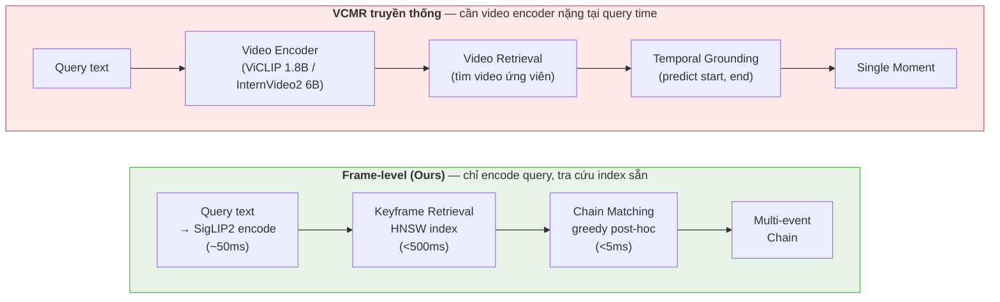
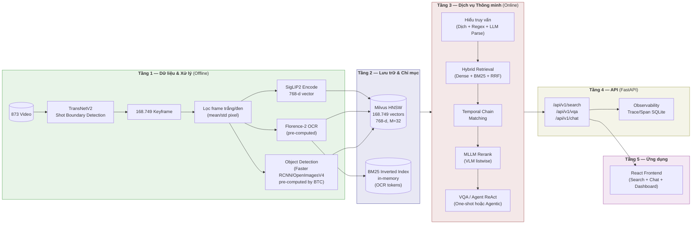
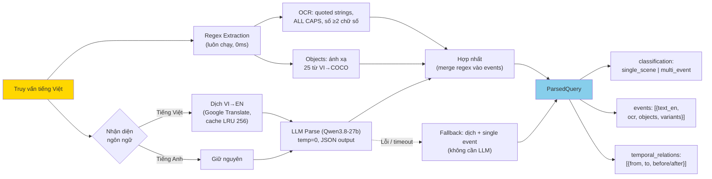
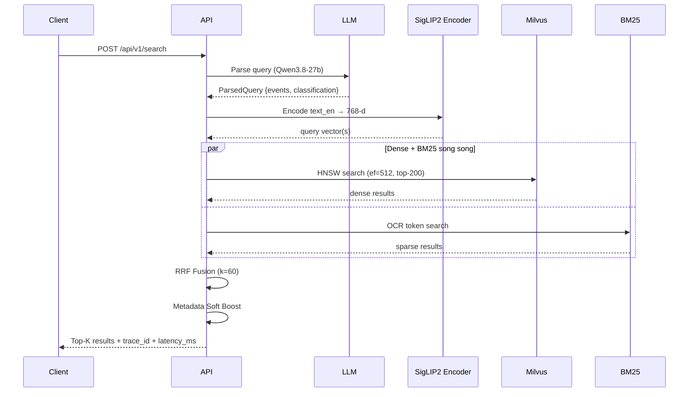
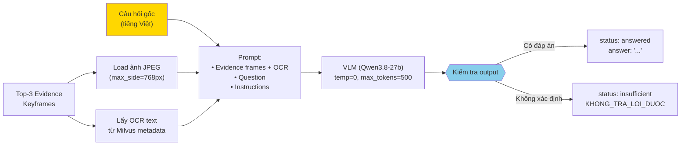
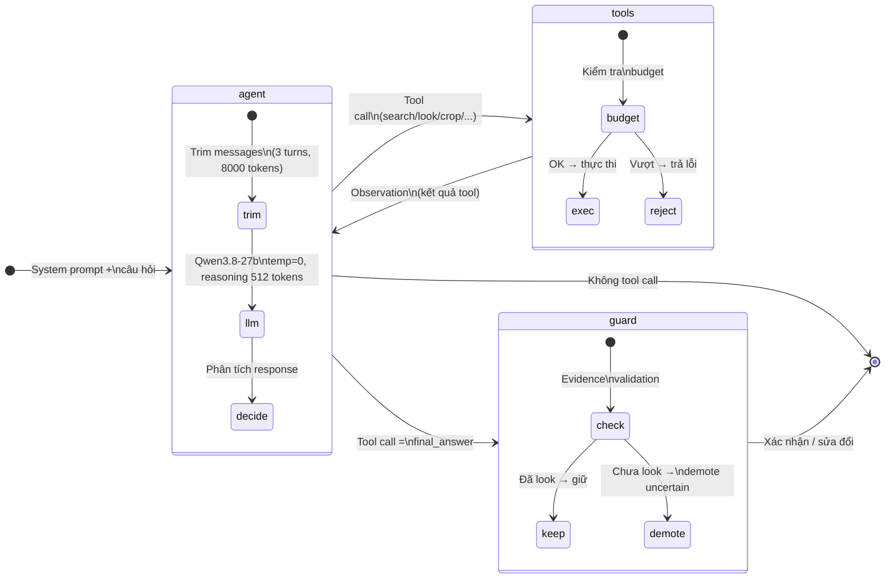
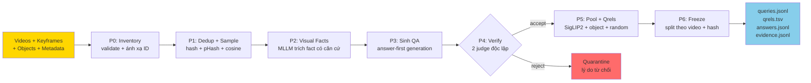
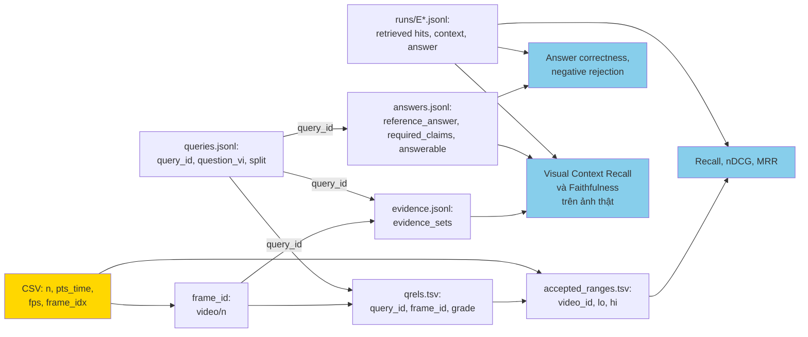

# Hệ thống Truy vấn và Hỏi đáp Sự kiện Video dựa trên Dữ liệu Đa phương thức

**Nhóm:** 12
**Thành viên:** Trang Kỳ Anh (250101006), Lê Nguyễn Bảo Hân (250101017), Đặng Anh Đạt (250101009)
**GVHD:** TS. Phạm Đỗ Kim Chi
**Trường:** Đại học Công Nghệ Thông Tin — ĐHQG TP.HCM

---

## Tóm tắt

Bài toán Visual Question Answering (VQA) trên kho video quy mô lớn đòi hỏi hệ thống vừa truy xuất đúng khoảnh khắc (moment) trong hàng trăm nghìn keyframe, vừa hiểu nội dung trực quan để trả lời câu hỏi. Báo cáo trình bày hệ thống VQA đa phương thức end-to-end cho cuộc thi AI Challenge 2025, xây dựng trên cách tiếp cận frame-level: tách video thành keyframe rồi kết hợp biểu diễn thị giác (SigLIP2, 768 chiều), văn bản trong ảnh (OCR), và nhãn đối tượng (object detection) để tạo chỉ mục đa tín hiệu. Pipeline truy vấn lai kết hợp dense retrieval và BM25 tự cài đặt qua Reciprocal Rank Fusion, bổ sung khớp chuỗi thời gian cho truy vấn đa sự kiện, và xếp hạng lại bằng Vision-Language Model. Hệ thống cung cấp hai chế độ hỏi đáp: thủ công (người dùng chọn bằng chứng) và tự động (ReAct agent trên LangGraph tự tìm kiếm, quan sát, và trả lời). Thực nghiệm trên benchmark silver pilot (20 QA, 416 qrels) cho thấy ReAct agent đạt Visual Context Recall 0,694, Faithfulness 0,929 — vượt trội so với pipeline cố định.

---

## 1. Giới thiệu

### 1.1 Bài toán

Visual Question Answering trên video (Video VQA) yêu cầu hệ thống thực hiện hai việc đồng thời: (1) tìm đúng khoảnh khắc chứa câu trả lời trong kho video lớn, và (2) trích xuất đáp án chính xác từ nội dung trực quan tại khoảnh khắc đó. Đây là bài toán kết hợp giữa truy xuất thông tin (information retrieval) và hiểu ngôn ngữ-thị giác (vision-language understanding).

Cuộc thi AI Challenge (AIC) 2025 đặt bài toán trong bối cảnh thực tế: kho dữ liệu gồm 873 video tin tức và phóng sự Việt Nam, được biểu diễn qua 168.749 keyframe. Truy vấn hoàn toàn bằng tiếng Việt dạng đoạn văn mô tả cảnh hoặc câu hỏi, hệ thống phải trả về đúng keyframe và (nếu là VQA) trả lời câu hỏi. Ràng buộc thời gian thực (5 phút/truy vấn) loại bỏ các phương pháp đòi hỏi mã hóa video toàn bộ tại runtime.

### 1.2 Tại sao chọn frame-level?

Cách tiếp cận trực quan nhất — mã hóa toàn bộ video bằng video encoder rồi so khớp với text encoder — gặp ba hạn chế nghiêm trọng:

- **Chi phí tính toán:** các video encoder SOTA (ViCLIP, InternVideo2 — 1.8B–6B tham số) đòi hỏi hàng chục GPU A100, vượt xa ngân sách của nhóm nghiên cứu.
- **Tín hiệu bị pha loãng:** video dài hàng phút nhưng moment chỉ vài giây; embedding toàn video trung bình hóa mất thông tin chi tiết.
- **Lỗi cascade:** pipeline video-level phụ thuộc chuỗi hai mô hình (video retrieval → temporal grounding) — lỗi ở tầng đầu lan truyền không hồi phục.

Thay vào đó, chúng tôi **reformulate bài toán**: dùng shot boundary detection tách video thành keyframe, rồi xử lý như bài toán truy xuất ảnh đa phương thức. Mỗi keyframe được bổ sung metadata giàu (OCR, objects, timestamp) để bù đắp cho việc mất ngữ cảnh thời gian. Cách tiếp cận này tận dụng hệ sinh thái mô hình ảnh phong phú (CLIP, SigLIP2) với chi phí thấp hơn nhiều lần.

### 1.3 Đóng góp

1. **Pipeline truy vấn lai end-to-end** kết hợp dense retrieval (SigLIP2) và BM25 tự cài đặt qua RRF tự cài đặt, tối ưu cho nội dung đa phương thức tiếng Việt.
2. **Module khớp chuỗi thời gian** (temporal chain matching) cho phép truy vấn đa sự kiện trên biểu diễn frame rời rạc.
3. **Hệ thống VQA hai chế độ:** pipeline one-shot (manual) và ReAct agent (agentic) dùng chung core retrieval, với guard node đảm bảo evidence-based answering.

---

## 2. Tập dữ liệu

### 2.1 Nguồn dữ liệu

Tập dữ liệu do Ban Tổ chức AIC 2025 cung cấp, gồm video tin tức và phóng sự từ các đài truyền hình Việt Nam (HTV, VTV, v.v.), thu thập từ YouTube. Dữ liệu chia thành 10 batch (L21–L30), tổng cộng 873 video.

### 2.2 Cấu trúc thư mục

Dữ liệu được tổ chức theo cấu trúc sau:

```
data/
├── Videos/                    # Video gốc (.mp4)
│   ├── L21_V001.mp4
│   ├── L21_V002.mp4
│   └── ...
├── Keyframes/                 # Keyframe trích xuất từ video
│   ├── L21_V001/
│   │   ├── 000.jpg
│   │   ├── 001.jpg
│   │   └── ...
│   ├── L21_V002/
│   └── ...
├── Objects/                   # Kết quả phát hiện vật thể (JSON)
│   ├── L21_V001/
│   │   ├── 000.json
│   │   ├── 001.json
│   │   └── ...
│   └── ...
├── CLIP-features/             # Embedding CLIP ViT-B-32 (npy)
│   └── features_L21.npy      # Vector features theo thứ tự keyframe
├── Metadata/                  # Metadata video từ YouTube (JSON)
│   ├── L21_V001.json
│   └── ...
└── map-keyframes/             # Ánh xạ keyframe ↔ vị trí trong video (CSV)
    ├── L21_V001.csv           # Cột: n, frame_idx, pts_time, fps
    └── ...
```

### 2.3 Mô tả chi tiết từng thành phần

**Videos:** File video gốc định dạng MP4. Mỗi video có thể dài từ vài chục giây đến hàng chục phút, nội dung đa dạng: bản tin thời sự, phóng sự, quảng cáo, gameshow, hướng dẫn nấu ăn, v.v.

**Keyframes:** Ảnh JPEG trích xuất từ video tại các điểm chuyển cảnh (scene change). Mỗi keyframe lưu trong thư mục tương ứng tên video (ví dụ: `L21_V001/042.jpg` là keyframe thứ 42 của video `L21_V001.mp4`). Tên file là chỉ số tăng dần, vị trí thời gian chính xác xem trong file map-keyframes tương ứng.

**Objects:** Kết quả phát hiện vật thể do BTC cung cấp, sử dụng mô hình **Faster RCNN pretrained trên OpenImagesV4** (qua TensorFlow Hub). Mỗi keyframe có file JSON tương ứng chứa danh sách object labels, bounding boxes, và confidence scores. Nhãn gốc từ OpenImagesV4 (~600 lớp) được chuẩn hóa về **80 lớp COCO-style** trong quá trình tiền xử lý trước khi nạp vào index.

**CLIP features:** Embedding từ mô hình **CLIP ViT-B-32** cho tất cả keyframe, lưu thành file `.npy` duy nhất cho mỗi batch. Thứ tự vector tương ứng chỉ số keyframe tăng dần. *Trong hệ thống của chúng tôi, chúng tôi không sử dụng CLIP features này mà thay bằng SigLIP2 (xem mục 2.4).*

**Metadata:** Thông tin YouTube của video gốc (tiêu đề, mô tả, tags, ngày đăng, kênh). Mỗi video một file JSON. Một số video có thể không có metadata.

**Map-keyframes:** File CSV ánh xạ mỗi keyframe đến vị trí chính xác trong video. Mỗi dòng gồm:
- `n`: chỉ số keyframe (tương ứng tên file ảnh)
- `frame_idx`: chỉ số frame trong video
- `pts_time`: thời điểm hiển thị (giây), dùng để xác định vị trí thời gian
- `fps`: tốc độ khung hình của video

### 2.4 Trích xuất keyframe và xử lý

#### Shot Boundary Detection

Keyframe được trích xuất bằng **TransNetV2** — mạng neural chuyên phát hiện điểm chuyển cảnh (shot boundary detection) trong video. TransNetV2 phân tích từng frame liên tiếp, gán xác suất là điểm cắt cảnh; khi xác suất vượt ngưỡng, frame đó được đánh dấu là ranh giới giữa hai cảnh (shot). Từ mỗi shot, keyframe đại diện được chọn.


#### Lọc frame nhiễu

Keyframe trích xuất tự động thường chứa frame trắng hoặc đen tại điểm chuyển cảnh. Chúng tôi lọc bằng thống kê pixel trên ảnh thu nhỏ $16 \times 16$:

$$\text{Loại bỏ nếu: } (\mu > 220 \wedge \sigma < 30) \vee (\mu < 15 \wedge \sigma < 10)$$

với $\mu$ là giá trị trung bình pixel và $\sigma$ là độ lệch chuẩn. Ngoài ra, ảnh có dung lượng > 60KB được bỏ qua kiểm tra (hầu chắc không phải frame trắng/đen).

#### Mã hóa lại bằng SigLIP2

BTC cung cấp CLIP ViT-B-32 features sẵn, tuy nhiên chúng tôi **mã hóa lại toàn bộ keyframe** bằng **SigLIP2** (`google/siglip2-base-patch16-512`) vì:

- SigLIP2 hỗ trợ đa ngôn ngữ tốt hơn CLIP gốc (quan trọng cho truy vấn tiếng Việt)
- Vector 768 chiều (so với 512 của CLIP ViT-B-32) biểu diễn phong phú hơn
- Kiến trúc NaViT xử lý nhiều độ phân giải đầu vào (512×512 mặc định), giữ chi tiết ảnh tốt hơn

#### Xử lý OCR

Văn bản OCR được trích xuất bằng **Florence-2** (pre-computed). Ký tự phân tách `<sep>` được thay bằng khoảng trắng, chuỗi được cắt tối đa 4096 ký tự trước khi lưu vào chỉ mục.

#### Xử lý Objects

Nhãn vật thể từ Faster R-CNN/OpenImagesV4 được giới hạn tối đa **20 object/keyframe**. Toàn bộ tập nhãn duy nhất được ghi ra `object_classes.json` phục vụ cho query enhancement.

### 2.5 Thống kê tập dữ liệu

| Thông số | Giá trị |
|---|---|
| Tổng số video | 873 |
| Tổng số keyframe (sau lọc) | 168.749 |
| Số batch | 10 (L21–L30) |
| Embedding dimension | 768 (SigLIP2) |
| Số lớp object duy nhất | 601 |
| Tỉ lệ keyframe có OCR | 72,4% |
| Số keyframe bị lọc (trắng/đen) | 1.247 |

---

## 3. Nghiên cứu liên quan

### 3.1 Biểu diễn đa phương thức

Contrastive learning đã tạo bước đột phá trong việc xây dựng không gian embedding chung cho text và ảnh. **CLIP** [1] huấn luyện cặp text-image encoder trên 400 triệu cặp ảnh-caption, cho phép so khớp trực tiếp text query với ảnh qua cosine similarity. Tuy nhiên, CLIP sử dụng hàm mất mát softmax đòi hỏi batch size rất lớn (32.768+) để hội tụ, và chỉ hỗ trợ phân giải cố định 224×224 — không phù hợp khi keyframe chứa chữ nhỏ cần nhận diện. **SigLIP** [2] thay thế softmax bằng sigmoid pairwise loss, loại bỏ hoàn toàn yêu cầu batch size lớn trong khi duy trì chất lượng embedding tương đương. **SigLIP2** [3] mở rộng thêm hai cải tiến quan trọng: (1) kiến trúc **NaViT** (Native Resolution ViT) [15] cho phép xử lý ảnh ở nhiều tỉ lệ và phân giải khác nhau không cần resize — bảo toàn chi tiết text trong keyframe; (2) huấn luyện đa ngôn ngữ mở rộng, cải thiện đáng kể khả năng cross-lingual retrieval.

| Mô hình | Hàm mất mát | Chiều | Phân giải | Đa ngôn ngữ | Yêu cầu batch |
|---|---|---|---|---|---|
| CLIP ViT-B-32 [1] | Softmax contrastive | 512 | 224 cố định | Yếu | 32K+ |
| SigLIP ViT-B-16 [2] | Sigmoid pairwise | 768 | 384 cố định | Một phần | Bất kỳ |
| SigLIP2 base-patch16-512 [3] | Sigmoid pairwise | 768 | 512 NaViT | Mạnh | Bất kỳ |

Chúng tôi chọn **SigLIP2 base-patch16-512** vì ba lý do: (a) phân giải 512px bảo toàn chi tiết OCR trên biển hiệu và subtitle trong video Việt Nam — CLIP 224px thường mất hoàn toàn thông tin text; (b) hỗ trợ đa ngôn ngữ cho phép encode truy vấn tiếng Việt dịch sang tiếng Anh mà vẫn khớp tốt với ảnh chứa text Việt; (c) sigmoid loss cho phép fine-tune với batch nhỏ trên GPU đơn nếu cần domain adaptation.

### 3.2 Truy vấn thưa và lai

**BM25** [4] là baseline mạnh cho truy vấn từ khóa chính xác — mã số, tên riêng, text literal — nơi dense retrieval thường gặp vocabulary mismatch. Trong hệ thống video, text không đến từ tài liệu truyền thống mà từ **OCR text trích xuất trên keyframe** (biển hiệu, phụ đề, chữ trên màn hình) — nguồn tín hiệu duy nhất mà dense embedding thường bỏ sót khi text nhỏ hoặc bị che một phần. Chúng tôi xây BM25 inverted index in-memory tại startup từ toàn bộ OCR text (Florence-2 [16] trích xuất offline), tokenizer xử lý tiếng Việt: NFC normalize → lowercase → strip dấu thanh → tách từ bằng regex `\w+`. **Reciprocal Rank Fusion (RRF)** [5] hợp nhất kết quả từ nhiều hệ thống (dense + BM25 trên OCR + variant queries) mà không cần chuẩn hóa điểm, chỉ dựa trên thứ hạng. Nhiều nghiên cứu chỉ ra hybrid retrieval vượt trội cả hai phương pháp đơn lẻ [6].

### 3.3 Temporal Search trên video

**Video Corpus Moment Retrieval (VCMR)** [7] mở rộng bài toán truy xuất từ single-video sang toàn bộ corpus. Bài toán cốt lõi: cho một truy vấn ngôn ngữ tự nhiên, tìm đoạn video (moment) phù hợp nhất trong toàn bộ corpus — đòi hỏi cả video-level retrieval lẫn temporal grounding.

#### Pipeline truyền thống vs. Cách tiếp cận frame-level

Hầu hết phương pháp VCMR tuân theo pipeline hai giai đoạn:



*Hình 2a: So sánh pipeline VCMR truyền thống (video-level, cần encoder nặng tại query time) với cách tiếp cận frame-level (keyframe đã index sẵn, chỉ cần encode query + tra cứu).*

**Giai đoạn 1 — Video Retrieval:** Chọn video ứng viên chứa nội dung liên quan. Phương pháp truyền thống cần video encoder (S3D, SlowFast, CLIP) chạy online trên mỗi video ứng viên — chi phí tuyến tính với corpus size. Cách tiếp cận frame-level tránh bước này hoàn toàn: encode toàn bộ keyframe offline, query time chỉ tra cứu index.

**Giai đoạn 2 — Temporal Grounding:** Xác định vị trí thời gian trong video. **Moment-DETR** [8] dùng transformer decoder dự đoán trực tiếp cặp (start, end) của moment. **UniVTG** [9] thống nhất moment retrieval, highlight detection, và video summarization trong một kiến trúc duy nhất, đạt SOTA trên QVHighlights và Charades-STA. Cả hai đều là **learned temporal models** — cần dữ liệu huấn luyện video-text paired. Cách tiếp cận frame-level thay thế bằng **post-hoc chain matching**: sắp xếp keyframe theo timestamps, tìm chuỗi thỏa mãn thứ tự thời gian, **không cần huấn luyện** (zero-shot).

| Phương pháp | Cách tiếp cận | Video encoder | Frame-level? | Đa sự kiện | Chi phí tính toán |
|---|---|---|---|---|---|
| TVR [7] | Hai giai đoạn: video ret. + subtitle grounding | Pretrained S3D | Không | Không | Cao (video encoding) |
| Moment-DETR [8] | Transformer decoder, dự đoán span | SlowFast / CLIP | Không | Không | Cao |
| UniVTG [9] | Kiến trúc thống nhất multi-task | CLIP ViT-B | Không | Hạn chế | Cao |
| **Ours** | Greedy chain matching trên keyframe rời rạc | SigLIP2 (ảnh) | **Có** | **Có (N events)** | **Thấp** |

#### Trade-off cốt lõi

Insight chính: đánh đổi **độ chính xác thời gian liên tục** (continuous temporal granularity) để lấy **chi phí tính toán thấp hơn nhiều lần** và khả năng **đa sự kiện native**. Cụ thể:

- **Mất:** Không thể xác định start/end time chính xác đến giây — chỉ đến cấp keyframe (~1–3s/shot tùy tần suất shot boundary).
- **Được:** (1) Không cần video encoder nặng online (ViCLIP 1.8B, InternVideo2 6B → chỉ SigLIP2 text encode ~50ms); (2) Zero-shot, không cần dữ liệu huấn luyện temporal; (3) Hỗ trợ native truy vấn đa sự kiện ("đầu tiên A, sau đó B, cuối cùng C") — tính năng mà hầu hết VCMR chỉ xử lý single-moment.

Trade-off này chấp nhận được trong bối cảnh cuộc thi: câu trả lời yêu cầu keyframe evidence, không yêu cầu timestamp chính xác. Chi tiết thuật toán chain matching trình bày ở Mục 5.4.

### 3.4 Xếp hạng lại đa phương thức

Cross-encoder reranking [10] cải thiện precision bằng cách đánh giá cặp (query, document) thay vì so khớp embedding độc lập. Trong bối cảnh multimodal, có hai paradigm chính: **pointwise scoring** — VLM chấm điểm từng ứng viên độc lập, nhanh nhưng không so sánh trực tiếp — và **listwise reranking** — gửi tập ảnh ứng viên cùng query cho VLM và yêu cầu xếp hạng, chậm hơn nhưng VLM nhìn thấy tất cả ứng viên cùng lúc. Chúng tôi áp dụng listwise làm mặc định vì chất lượng ranking cao hơn trên benchmark, với pointwise làm fallback khi timeout. **Florence-2** [16] được sử dụng cho OCR extraction offline, cung cấp text context bổ sung cho cả reranking và VQA.

### 3.5 Agent cho VQA

**ReAct** [11] kết hợp reasoning và acting trong vòng lặp Thought → Action → Observation, cho phép LLM sử dụng công cụ bên ngoài. Trước đó, **Toolformer** (Schick et al., 2023) chứng minh LLM có thể tự học cách sử dụng tool, nhưng thiếu cơ chế kiểm soát luồng phức tạp. **LangGraph** [12] cung cấp framework xây dựng agent dạng đồ thị trạng thái (state graph), cho phép kiểm soát budget, routing có điều kiện, và xử lý timeout — phù hợp cho VQA nơi agent cần giới hạn số lần gọi VLM.

Đóng góp thiết kế chính của hệ thống là **verify-then-answer pattern**: guard node bắt buộc agent phải `look` (quan sát ảnh qua VLM [17]) mọi evidence trước khi trả lời — frame chưa xem bị demote thành `uncertain`. Mô hình này khác với ReAct chuẩn (không ràng buộc evidence), giảm đáng kể hallucination trong thực nghiệm (Faithfulness 0,929 vs 0,571 của pipeline cố định).

---

## 4. Kiến trúc hệ thống

Hệ thống được tổ chức theo kiến trúc **5 tầng**, tuân thủ nguyên tắc **offline nặng, online nhẹ**: parse, encode, index chạy batch một lần; online chỉ encode truy vấn, tra cứu, rerank, và sinh câu trả lời.



*Hình 1: Kiến trúc 5 tầng. Tầng 1–2 chạy offline một lần; Tầng 3–5 xử lý online mỗi truy vấn.*

#### Nguyên tắc thiết kế: offline nặng, online nhẹ

Toàn bộ chi phí tính toán lớn — encode 168.749 keyframe bằng SigLIP2, trích xuất OCR bằng Florence-2 [16], nhận diện object bằng Faster RCNN/OpenImagesV4 (do BTC cung cấp), xây BM25 inverted index — thực hiện **offline một lần** (~4 giờ trên GPU đơn). Online chỉ cần encode text query (<50ms), tra cứu HNSW (<500ms p95), và gọi VLM khi cần rerank/VQA. Kết quả: hệ thống có thể phục vụ truy vấn trên máy không có GPU nếu dùng embedding API cho query, vì retrieval thuần chỉ là vector search trên index đã tính sẵn.

#### Mô tả chi tiết từng tầng

**Tầng 1 — Dữ liệu & Xử lý (Offline):** TransNetV2 [14] phát hiện shot boundary, tạo keyframe đại diện cho mỗi shot. Keyframe qua bộ lọc blank frame (loại ảnh trắng/đen chuyển cảnh), sau đó được encode bằng SigLIP2 thành vector 768 chiều. OCR text (Florence-2 [16]) và object labels (Faster RCNN/OpenImagesV4, chuẩn hóa 80 lớp COCO-style) được trích xuất sẵn và lưu cùng vector dưới dạng pickle. Metadata thời gian (pts_time, fps, frame_idx) đọc từ CSV map-keyframes do BTC cung cấp.

**Tầng 2 — Lưu trữ & Chỉ mục:** Vector được nạp vào **Milvus** [18] với index **HNSW** [19] (M=32, efConstruction=256, metric COSINE) cho trường `text_vector` 768 chiều. BM25 inverted index xây in-memory tại startup từ toàn bộ OCR text trong Milvus — tokenizer xử lý tiếng Việt (NFC normalize → lowercase → strip dấu thanh → tách từ bằng regex `\w+`). Milvus chạy embedded mode (file-based, không cần server process riêng), giảm phức tạp triển khai.

**Tầng 3 — Dịch vụ Thông minh (Online):** Gồm 5 module stateless, giao tiếp qua Python object in-process (không network hop): (1) Query Understanding — dịch VI→EN + regex extraction + LLM parse; (2) Hybrid Retrieval — dense HNSW + BM25 + RRF fusion; (3) Temporal Chain Matching — cho truy vấn đa sự kiện; (4) MLLM Rerank — VLM [17] listwise hoặc pointwise; (5) VQA/Agent — one-shot pipeline hoặc ReAct agent.

**Tầng 4 — API:** FastAPI với ba endpoint chính: `/api/v1/search` (truy vấn keyframe), `/api/v1/vqa` (hỏi đáp one-shot), `/api/v1/chat` (agent ReAct qua SSE streaming). Mỗi request tạo một trace với các span có latency, lưu vào SQLite — phục vụ dashboard giám sát và phân tích hiệu năng.

**Tầng 5 — Ứng dụng:** React frontend gồm search panel (kết quả grid), chat interface (SSE streaming hiển thị agent timeline), và dashboard (latency, QPS, error rate, cost).

| Tầng | Công nghệ chính | Latency đóng góp | Offline/Online |
|---|---|---|---|
| 1. Dữ liệu | TransNetV2, SigLIP2, Florence-2 | ~4h (một lần) | Offline |
| 2. Lưu trữ | Milvus HNSW, BM25 in-memory | ~30s build (startup) | Offline |
| 3. Truy vấn | SigLIP2 encode, Milvus search, RRF | 114ms p50 (retrieval) | Online |
| 4. API | FastAPI, SQLite traces | <5ms overhead | Online |
| 5. Ứng dụng | React, SSE | Client-side | Online |

---

## 5. Phương pháp

### 5.1 Ingestion (Offline)

Toàn bộ keyframe được xử lý offline và nạp vào chỉ mục. Pipeline ingestion:

1. **Load features:** Đọc file pickle chứa pre-computed vectors (SigLIP2 768-d), OCR text (Florence-2 [16]), và object labels (Faster RCNN/OpenImagesV4, chuẩn hóa 80 lớp).
2. **Load map-keyframes:** Đọc CSV ánh xạ `(n, frame_idx, pts_time, fps)` cho mỗi keyframe.
3. **Lọc frame trắng/đen:** Downsample ảnh về 16×16, tính $\mu$ (mean) và $\sigma$ (std) pixel. Frame bị loại nếu: $(\mu > 220 \wedge \sigma < 30)$ (trắng chuyển cảnh) hoặc $(\mu < 15 \wedge \sigma < 10)$ (đen chuyển cảnh). File > 60KB được bỏ qua kiểm tra vì gần chắc chắn không phải blank frame.
4. **Xử lý OCR:** Thay `<sep>` bằng khoảng trắng, cắt 4096 ký tự.
5. **Insert Milvus:** Batch 1000 dòng, tạo HNSW index (M=32, efConstruction=256, metric=COSINE) cho vector 768-d.
6. **Build BM25 index:** Tại startup, đọc toàn bộ OCR từ Milvus, tokenize (NFC normalize → lowercase → strip dấu thanh → regex `\w+`), xây inverted index in-memory.

Schema Milvus (`aic25_keyframes`):

| Trường | Kiểu | Mô tả |
|---|---|---|
| `id` | VARCHAR(32) | Khóa chính `L{batch}_V{video}/{idx:03d}` |
| `text_vector` | FLOAT_VECTOR(768) | Embedding SigLIP2 |
| `ocr` | VARCHAR(4096) | Văn bản OCR (Florence-2) |
| `objects` | ARRAY\<VARCHAR\> | Nhãn object, tối đa 20 |
| `video_name` | VARCHAR(16) | Định danh video |
| `keyframe_idx` | INT32 | Chỉ số keyframe |
| `frame_idx` | INT64 | Chỉ số frame trong video |
| `pts_time` | FLOAT | Thời điểm trong video (giây) |
| `fps` | FLOAT | Tốc độ khung hình |

### 5.2 Hiểu truy vấn (Query Understanding)

Truy vấn đầu vào bằng tiếng Việt trải qua ba bước xử lý song song rồi hợp nhất:



*Hình 2: Pipeline hiểu truy vấn. Regex chạy song song với LLM parse; khi LLM thất bại, fallback về dịch thuần.*

**Regex Extraction** trích xuất tức thì (không cần LLM):
- Chuỗi trong dấu ngoặc kép, từ viết HOA ≥ 2 ký tự, số ≥ 2 chữ số → OCR candidates
- Ánh xạ 25 từ Việt sang nhãn object (COCO-style, 80 lớp đã chuẩn hóa từ OpenImagesV4): "người"→person, "xe hơi"/"ô tô"→car, "xe máy"→motorcycle, v.v. → Object candidates

**LLM Parse** (Qwen3.8-27b, temperature=0) phân tích truy vấn thành JSON:
- `classification`: `"single_scene"` (một cảnh) hoặc `"multi_event"` (nhiều sự kiện → kích hoạt temporal search)
- `events[]`: mỗi sự kiện có `text_en` (mô tả cảnh tiếng Anh), `ocr`, `objects`, `variants` (1–3 cách diễn đạt thay thế)
- `temporal_relations[]`: quan hệ thời gian giữa events

**Fallback:** Khi LLM không khả dụng hoặc parse lỗi → dịch toàn bộ query sang tiếng Anh, tạo single-event ParsedQuery. Hệ thống vẫn hoạt động (mất multi-event classification và variants).

### 5.3 Truy vấn lai (Hybrid Retrieval)

Thiết kế tuân thủ nguyên tắc **recall trước, precision sau**: tầng 1 tập trung không bỏ sót ứng viên đúng (top-200), tầng 2 (rerank) mới tối ưu vị trí ranking (top-10).

#### Dense Retrieval

`text_en` của mỗi event được encode bằng SigLIP2 thành vector 768-d, tìm top-$N$ nearest neighbors trong Milvus:

$$\text{sim}(q, f) = \cos(\mathbf{v}_q, \mathbf{v}_f) = \frac{\mathbf{v}_q \cdot \mathbf{v}_f}{||\mathbf{v}_q|| \cdot ||\mathbf{v}_f||}$$

Tham số search: HNSW `ef = 512`, `metric = COSINE`, `top_k = 200`. Khi có variant queries, mỗi variant được encode riêng và tạo thêm danh sách kết quả.

#### BM25 (tự cài đặt)

BM25 hoạt động trên trường OCR, truy vấn text literal (tên đường, biển số, tiêu đề, v.v.):

$$\text{BM25}(q, d) = \sum_{t \in q} \text{IDF}(t) \cdot \frac{tf_{t,d} \cdot (k_1 + 1)}{tf_{t,d} + k_1 \cdot (1 - b + b \cdot \frac{|d|}{\text{avgdl}})}$$

$$\text{IDF}(t) = \log\left(\frac{N - df_t + 0.5}{df_t + 0.5} + 1\right)$$

Tham số: $k_1 = 1.5$, $b = 0.75$. Tokenizer xử lý tiếng Việt: NFC normalize → lowercase → strip dấu thanh (NFD + loại combining marks) → tách từ bằng `\w+`.

**BM25 cần thiết vì:** dense retrieval mạnh về ngữ nghĩa nhưng không phân biệt được chuỗi text cụ thể. Ví dụ: "biển số 51A-12345" — SigLIP2 embedding không mã hóa chuỗi ký tự chính xác, trong khi BM25 match trực tiếp trong OCR.

#### Reciprocal Rank Fusion — RRF (tự cài đặt)

Kết quả từ dense, BM25, và variants được hợp nhất:

$$\text{RRF}(d) = \sum_{l \in \mathcal{L}} \frac{1}{k + \text{rank}_l(d) + 1}$$

với $\mathcal{L}$ là tập danh sách kết quả (dense, BM25, variant queries, upvote signals), $k = 60$.

RRF không cần chuẩn hóa điểm — chỉ dựa trên thứ hạng — nên robust với sự khác biệt phân phối điểm giữa dense (cosine ∈ [0,1]) và BM25 (unbounded).

#### Metadata Soft Boost

Tăng cường nhẹ dựa trên Jaccard similarity giữa query terms và metadata (OCR + objects):

$$\text{score}'(d) = \text{score}(d) \cdot (1 + \min(\alpha \cdot J(q, d), \beta))$$

với $\alpha = 0.05$, $\beta = 0.1$. Boost có cận trên 10% — đủ để phân biệt ứng viên gần điểm, không đủ để ghi đè tín hiệu semantic.

#### Sequence Diagram truy vấn



*Hình 3: Sequence diagram truy vấn đơn. Dense và BM25 chạy song song; mọi bước là một span có latency.*

### 5.4 Khớp chuỗi thời gian (Temporal Chain Matching)

Khi query được phân loại `multi_event` (ví dụ: "Đầu tiên thấy cảnh biển, sau đó người ta vào chợ"), hệ thống cần tìm chuỗi keyframe **cùng video** thỏa mãn thứ tự thời gian.

#### Vấn đề

Retrieval trên keyframe đơn lẻ không nắm bắt quan hệ thời gian. Mỗi event $E_i$ có tập ứng viên $C_i$ từ retrieval, nhưng cần tìm tổ hợp $(c_1, c_2, \ldots, c_n)$ sao cho: (a) tất cả thuộc cùng video, (b) timestamp tăng dần: $t(c_1) < t(c_2) < \ldots < t(c_n)$.

#### Thuật toán Greedy

```mermaid
flowchart LR
    IN["N tập ứng viên\nC₁, C₂, ..., Cₙ\n(mỗi event 1 tập,\ntối đa 200 ứng viên)"] --> GROUP["Nhóm theo video_name\n(chỉ giữ video có ≥ 2 events)"]
    GROUP --> ANCHOR["Chọn anchor: top-50\nứng viên Event 1\ntheo score giảm dần"]

    ANCHOR --> LOOP["Với mỗi anchor f₁\n(prev_ts = f₁.pts_time)"]
    LOOP --> NEXT["Event tiếp theo Eᵢ"]
    NEXT --> FILTER["Lọc ứng viên:\npts_time > prev_ts\n∧ gap ≤ max_gap_s"]
    FILTER --> PICK["Chọn ứng viên\ncó score cao nhất"]
    PICK --> UPD["prev_ts = fᵢ.pts_time"]
    UPD --> CHK{{"Còn event?"}}
    CHK -->|Có| NEXT
    CHK -->|Không| BUILD["Xây dựng chain"]

    BUILD --> SCORE["chain_score =\nmean_relevance × coverage"]
    SCORE --> DEDUP["Loại trùng:\n1 chain/answer-event kf"]
    DEDUP --> TOP["Top-20 chains"]

    style IN fill:#ffd700
    style TOP fill:#87ceeb
```



*Hình 4: Thuật toán Greedy Temporal Chain Matching.*

**Chain scoring:**

$$\text{chain\_score} = \underbrace{\frac{1}{|F|} \sum_{f \in F} s_f}_{\text{mean relevance}} \times \underbrace{\frac{|F|}{n}}_{\text{coverage ratio}}$$

Chain hợp lệ khi phủ ít nhất $\max(2, n-1)$ events — cho phép bỏ sót tối đa 1 event. Chains được loại trùng theo answer-event keyframe (giữ chain score cao nhất).

#### Pseudocode

```
Algorithm 1: Greedy Temporal Chain Matching
─────────────────────────────────────────────
Input:  Per-event candidate sets C₁..Cₙ (mỗi tập ≤ 200 ứng viên),
        max_gap_s (giới hạn khoảng cách thời gian, tùy chọn)
Output: Top-20 chains xếp hạng theo chain_score

 1. Nhóm tất cả ứng viên theo video_name
 2. Loại video có ứng viên cho < 2 events
 3. FOR mỗi video V:
 4.   FOR mỗi anchor a ∈ C₁[V][:50] (top-50 theo score):
 5.     chain ← [a];  prev_ts ← a.pts_time
 6.     FOR event i = 2..N:
 7.       best ← argmax{score(c)} với c ∈ Cᵢ[V]
 8.              sao cho c.pts_time > prev_ts
 9.              ∧ (max_gap_s = ∅ ∨ c.pts_time − prev_ts ≤ max_gap_s)
10.       IF best tồn tại: chain.append(best); prev_ts ← best.pts_time
11.     IF |chain| ≥ max(2, N−1): emit chain
12. Score: chain_score = mean(scores) × coverage_ratio
13. Loại trùng theo answer-event kf_id (giữ chain score cao nhất)
14. RETURN top-20 chains
```

#### Tham số `max_gap_s`

Tham số `max_gap_s` (mặc định: không giới hạn) ràng buộc khoảng cách thời gian tối đa giữa hai event liên tiếp trong chain. Khi được thiết lập (ví dụ: 120s), hệ thống chỉ chấp nhận chain mà mọi cặp event liền kề cách nhau ≤ 120 giây — ngăn chặn việc ghép hai cảnh ở đầu và cuối video dài thành chain giả. Hiện tại để mặc định vì video tin tức thường ngắn (2–5 phút), nhưng có thể cần thiết khi mở rộng sang video dài hơn.

#### Phân tích độ phức tạp

Gọi $V$ = số video có ứng viên cho ≥ 2 events, $A$ = giới hạn anchor (50), $E$ = số events, $K$ = ứng viên tối đa mỗi event (200). Trường hợp xấu nhất: $O(V \times A \times E \times K)$. Với giá trị điển hình ($V \approx 50$, $A = 50$, $E = 2\text{–}3$, $K = 200$), tổng so sánh khoảng 1,5 triệu — latency không đáng kể (<5ms, xác nhận từ traces thực tế). Bottleneck thực sự nằm ở retrieval per-event ($E$ lần gọi Milvus), không phải chain matching.

**Biến thể Adaptive Tolerance:** Bổ sung early-stopping: nếu duyệt `tolerance_threshold` (mặc định 3) ứng viên liên tiếp mà không cải thiện score → dừng sớm, giảm $K$ hiệu dụng. Tùy chọn dùng cosine similarity với query vector thay vì raw retrieval score — cho phép so sánh trực tiếp giữa ứng viên từ nhiều nguồn retrieval.

#### So sánh với VCMR end-to-end

| Khía cạnh | VCMR end-to-end [7][8][9] | Cách tiếp cận của chúng tôi |
|---|---|---|
| Input | Raw video frames | Keyframe embeddings đã tính sẵn |
| Mô hình temporal | Learned (transformer/decoder) | Greedy chain trên timestamps rời rạc |
| Cần huấn luyện | Có (dữ liệu video-text paired) | Không (zero-shot) |
| Độ chính xác thời gian | Liên tục (start/end times) | Rời rạc (keyframe timestamps) |
| Chi phí query time | Nặng (video encoding) | Nhẹ (sort + filter, <5ms) |
| Hỗ trợ đa sự kiện | Hạn chế (single moment/query) | Native ($N$ events, thứ tự thời gian) |

Hạn chế: thuật toán greedy có thể bỏ sót chain tối ưu khi event scores nhiễu — cụ thể khi event 1 không có ứng viên mạnh trong video đúng nhưng event 2 hoặc 3 có. Cải tiến tiềm năng: beam search thay greedy, hoặc learned scoring với gap penalty.

### 5.5 Xếp hạng lại (Reranking)

#### MLLM Listwise Reranking (mặc định)

Lấy top-10 ứng viên sau fusion, gửi ảnh kèm query cho VLM (Qwen3.8-27b), yêu cầu trả về JSON array xếp hạng từ phù hợp nhất đến ít phù hợp nhất.

- Ảnh resize `max_side = 384px`, encode base64 JPEG
- Timeout: 15.000ms
- Fallback: nếu timeout hoặc parse lỗi → giữ nguyên thứ tự trước rerank

**Ưu điểm listwise:** VLM nhìn thấy tất cả ứng viên cùng lúc, so sánh trực tiếp thay vì chấm điểm độc lập → ranking chính xác hơn pointwise.

#### VLM Pointwise Scoring (phương pháp thay thế)

Gửi ảnh theo batch 4, yêu cầu VLM chấm điểm 0–10 cho mỗi ứng viên. Nhanh hơn listwise nhưng không so sánh trực tiếp giữa ứng viên.

### 5.6 Hỏi đáp trực quan (VQA)

#### Pipeline One-shot

Sau khi có top evidence keyframe, hệ thống tạo prompt multimodal chứa cả ảnh lẫn OCR text:



*Hình 5: Pipeline VQA one-shot. OCR context chèn trực tiếp vào prompt bên cạnh ảnh.*

Cấu trúc prompt VQA:

```
Evidence frames:
Image 1: keyframe L30_V078/031 (event E1) at 45.2s
  Text visible in frame: Nhân bánh cuốn — Nạc dăm xay 200 gr
Image 2: keyframe L30_V078/030 (event E1) at 43.1s
  Text visible in frame: Công thức làm bánh cuốn

Question: <câu hỏi gốc tiếng Việt>

Instructions:
- Answer based on what you can see AND the OCR text provided.
- The 'Text visible in frame' lines contain OCR-extracted text.
- If you cannot determine the answer, respond: KHONG_TRA_LOI_DUOC
- Do NOT guess information not visible in the frames.
```

**OCR context chèn vào prompt** vì VLM ở độ phân giải thấp (768px) không đáng tin cậy khi đọc chữ Việt in nhỏ, chữ viết tay, hoặc chữ trên biển hiệu. OCR đã trích xuất offline bằng Florence-2 — chèn trực tiếp giúp VLM có tín hiệu text bổ sung.

### 5.7 Agent ReAct

Bên cạnh pipeline one-shot (cố định), hệ thống cung cấp chế độ **agentic** — ReAct agent tự động lập kế hoạch, tìm kiếm, quan sát, và trả lời.

#### Đồ thị trạng thái (LangGraph)



*Hình 6: State diagram ReAct agent. Ba node: agent (suy luận LLM), tools (thực thi + budget), guard (xác nhận evidence).*

#### Bộ công cụ

| Tool | Mode | Chức năng | Giới hạn |
|---|---|---|---|
| `search` | Agentic | Encode text → dense search trong Milvus | Max 3 calls |
| `search_events` | Agentic | Multi-event retrieval + temporal matching | Max 3 calls |
| `look` | Cả hai | Gửi ảnh keyframe cho VLM quan sát, đọc chữ | Max 5 calls, 4 frames/call |
| `crop` | Cả hai | Cắt vùng ảnh, kiểm tra ở 1024px (chi tiết cao) | — |
| `neighbors` | Cả hai | Lấy keyframe lân cận cùng video | 3 frames/hướng |
| `read_ocr` | Cả hai | Đọc OCR text từ Milvus (không gọi VLM, rất nhanh) | 20 kf_ids/call |
| `final_answer` | Cả hai | Nộp đáp án kèm status + evidence | — |

#### Hai chế độ vận hành

| | **Manual** | **Agentic** |
|---|---|---|
| **Endpoint** | `/api/v1/ask` | `/api/v1/chat` (SSE stream) |
| **Tools** | 5 tools (không có search) | Đầy đủ 7 tools |
| **Input** | Câu hỏi + kf_ids (người dùng chọn) | Chỉ câu hỏi |
| **Khi nào dùng** | Người dùng đã tìm được frame, cần đọc/trả lời | Truy vấn mở, hệ thống tự tìm |

#### Guard Node

Trước khi trả đáp án, guard kiểm tra:
1. Mọi evidence kf_id phải khớp pattern `^L\d+_V\d+/\d{3,}$`
2. Mọi evidence kf_id phải đã được `look` (agent thực sự xem ảnh)
3. Vi phạm → demote status thành `"uncertain"`, đánh dấu `guard_changed: true`

Nguyên tắc: agent chỉ được trả lời dựa trên bằng chứng đã quan sát, không được bịa từ search results.

#### Kiểm soát ngân sách

| Tham số | Mặc định | Ý nghĩa |
|---|---|---|
| `max_search_calls` | 3 | Số lần gọi search/search_events |
| `max_look_calls` | 5 | Số lần gọi look (VLM) |
| `recursion_limit` | 12 | `2 × max_steps + 2`, giới hạn LangGraph |
| `timeout_s` | 60 | Timeout toàn bộ agent run |

Khi vượt budget, tool trả lỗi thay vì thực thi → buộc agent kết luận với thông tin hiện có.

---

## 6. Thực nghiệm

### 6.1 Tập đánh giá

Benchmark gồm **20 cặp QA** với **416 qrels** (116 positive grade ≥ 2, 271 negative grade = 0), sinh và kiểm chứng bằng MLLM (Qwen3.8-flash). Đây là nhãn silver, chưa được chuyên gia xác nhận. Quy trình:

1. Trích mẫu keyframe, trích xuất visual facts bằng VLM
2. Sinh câu hỏi QA, phân loại theo 6 dạng
3. Xác minh: blind visual pass + question-aware comparison
4. Freeze thành benchmark cố định

| Dạng câu hỏi | Số lượng | Ví dụ |
|---|---|---|
| `visible_action` | 4 | "Người phụ nữ đang làm gì?" |
| `spatial_count` | 4 | "Có bao nhiêu người trong khung hình?" |
| `multi_frame_temporal` | 3 | "Sau khi A xảy ra, B là gì?" |
| `unanswerable` | 3 | Câu hỏi không có đáp án trong corpus |
| `object_attribute` | 4 | "Màu áo của người đàn ông?" |
| `ocr_signage` | 2 | "Tên quán trên biển hiệu?" |

#### Schema dữ liệu

Bộ eval pilot nằm ở `data/video_rag_eval/benchmark/v1/` (artifact cục bộ, không commit vào Git). Phiên bản hiện tại có 20 QA: 6 `dev`, 14 `test`, và 416 nhãn qrel. Đây là **silver/pseudo-ground-truth** do MLLM sinh và kiểm chứng, chưa phải nhãn chuyên gia.

#### Ground truth nằm ở đâu?

Benchmark **không có một file `ground_truth.json` duy nhất**. Ground truth (chính xác hơn là *silver reference labels*) được tách theo đơn vị cần chấm và nối bằng `query_id`:

| Phép chấm | File nhãn tham chiếu | Trường dùng làm ground truth |
| --- | --- | --- |
| Trả lời VQA | `answers.jsonl` | `reference_answer`, `required_claims`, `answerable` |
| Bằng chứng thị giác và coverage | `evidence.jsonl` | `evidence_sets[].frame_ids`, `required_all`, `crop_paths` |
| Truy hồi keyframe | `qrels.tsv` | `(query_id, frame_id, grade)`; chỉ frame đã được judge mới có dòng |
| Truy hồi theo khoảng frame gốc | `accepted_ranges.tsv` | Khoảng `[lo_frame_idx, hi_frame_idx]` suy ra từ qrels và map-keyframes, không phải nhãn độc lập |

`queries.jsonl` chứa câu hỏi, mô tả truy hồi và `split`, tức **đầu vào** để chấm; `splits.json` xác định video thuộc `dev`/`test`; `benchmark_manifest.json` ghi phiên bản và hash của bộ nhãn đóng băng. Các file `runs/E*.jsonl` là **đầu ra hệ thống**, không phải ground truth. Với câu `answerable=false`, `reference_answer` và `required_claims` để trống; điểm *negative rejection* kiểm tra hệ thống có từ chối trả lời đúng hay không.

#### Quy ước chung

- `query_id` (ví dụ `Q0001`) là khóa nối giữa các file. Mỗi `queries.jsonl`, `answers.jsonl`, `evidence.jsonl` có đúng một dòng cho mỗi `query_id`.
- JSONL dùng UTF-8; mỗi dòng là một object JSON độc lập. TSV dùng tab làm dấu phân cách.
- `frame_id`/`kf_id` có dạng `L22_V019/054`: phần trước dấu `/` là `video_id`, phần sau là chỉ số keyframe. `source_frame_id` và `frame_ids` dùng cùng định dạng.
- Các file nhãn đóng băng nằm trong `benchmark/v1/`; kết quả chạy mô hình nằm ở `data/video_rag_eval/runs/`, điểm chấm ở `data/video_rag_eval/eval/`.

#### `queries.jsonl`

| Trường | Kiểu | Ý nghĩa |
| --- | --- | --- |
| `query_id` | string | Khóa QA, duy nhất. |
| `description_vi` | string | Mô tả cảnh để truy hồi; không chứa đáp án. |
| `question_vi` | string | Câu hỏi VQA bằng tiếng Việt. |
| `question_type` | string | Loại câu hỏi, ví dụ `visible_action`, `ocr_signage`, `unanswerable`. |
| `answerable` | boolean | Có thể trả lời từ ảnh nguồn hay không. |
| `split` | `dev` hoặc `test` | Tập đánh giá; tách theo video/nhóm video trùng lặp. |

```json
{"query_id":"Q0001","description_vi":"Mô tả cảnh không tiết lộ đáp án","question_vi":"Người trong ảnh đang làm gì?","question_type":"visible_action","answerable":true,"split":"test"}
```

#### `answers.jsonl`

| Trường | Kiểu | Ý nghĩa |
| --- | --- | --- |
| `query_id` | string | Nối với `queries.jsonl`. |
| `reference_answer` | string | Đáp án tham chiếu; với câu không trả lời được, xem thêm `answerable`. |
| `required_claims` | string[] | Các mệnh đề cần đúng trong câu trả lời. |
| `answerable` | boolean | Cờ khả năng trả lời sau bước xác minh. |
| `label_status` | string | Trạng thái nhãn, hiện là `verified_silver`. |

#### `evidence.jsonl`

| Trường | Kiểu | Ý nghĩa |
| --- | --- | --- |
| `query_id` | string | Nối với câu hỏi và đáp án. |
| `source_video_id` | string | Video nguồn của đề xuất QA. |
| `source_frame_id` | string | Keyframe nguồn của đề xuất QA. |
| `temporal_relation` | string hoặc null | Quan hệ thời gian nếu QA cần nhiều frame; hiện có `ordered` hoặc `null`. |
| `evidence_sets` | object[] | Một hoặc nhiều tập ảnh đủ làm bằng chứng. |
| `judge_ids` | string[] | Các lượt judge đã xác minh nhãn. |

Mỗi phần tử `evidence_sets` gồm `set_id` (string), `frame_ids` (string[]), `required_all` (boolean) và `crop_paths` (string[]). `required_all=true` nghĩa là cần đủ các frame trong tập đó để kiểm chứng câu trả lời.

#### `qrels.tsv` và `accepted_ranges.tsv`

`qrels.tsv` **không có header**. Bốn cột theo thứ tự: `query_id`, `iteration` (luôn `0`), `frame_id`, `grade`. `grade` là số nguyên 0–3; nhãn liên quan tích cực dùng ngưỡng `grade >= 2` theo cấu hình đánh giá.

```text
Q0001\t0\tL21_V001/203\t0
```

`accepted_ranges.tsv` **có header**: `query_id`, `video_id`, `lo_frame_idx`, `hi_frame_idx`, `grade`, `source_frame_id`. Hai cột `lo_frame_idx` và `hi_frame_idx` là biên bao gồm của khoảng frame video gốc; hit chỉ khớp khi cùng video và `frame_idx` nằm trong khoảng. Khoảng này dùng cho truy hồi/citation, không tự chứng minh nội dung ảnh.


#### Quy trình sinh benchmark tự động (MLLM-based)

Benchmark được sinh **hoàn toàn tự động** bằng MLLM, không cần người gán nhãn. Nhãn là **silver/pseudo-ground-truth** — do MLLM tạo và xác minh, không phải nhãn chuyên gia. Các nguyên tắc thiết kế:

- **Một bộ câu hỏi chung**, nhiều bảng nhãn liên kết bởi `query_id`: `queries.jsonl` + `qrels.tsv` + `answers.jsonl` + `evidence.jsonl`
- **Đơn vị truy hồi là `frame_id`**: không dùng shot/scene làm nhãn chính
- **MLLM sinh + hai lượt judge xác minh**: cùng checkpoint với prompt độc lập; bất đồng → reject
- **Chống trùng trước khi lấy mẫu**: xây nhóm near-duplicate, chọn frame đại diện, không xóa frame gốc khỏi kho
- **Qrels đa nguồn**: pool từ SigLIP2 + object-based + random negatives, MLLM chấm từng frame blind (không thấy rank/score)



*Hình 7: Pipeline sinh benchmark tự động. MLLM sinh QA (P3), hai lượt judge dùng prompt độc lập để xác minh (P4); bất đồng dẫn đến quarantine.*

**Thang nhãn qrels (TREC format):** `3` = bằng chứng trực tiếp, đáp án đọc/nhìn được; `2` = gần đủ, chi tiết quyết định chưa rõ; `1` = đúng bối cảnh, không tự trả lời được; `0` = đã judge, không liên quan. Không có dòng qrels = **chưa phán nhãn**, không tự động coi là 0.

#### Thống kê benchmark pilot

| Chỉ số | Giá trị |
|---|---:|
| Video đã quét (pilot) | 128 / 873 |
| Frame hợp lệ | 26.003 |
| Nhóm near-duplicate | 25.874 |
| Frame lấy mẫu | 120 |
| Video có mẫu | 88 |
| Proposal qua judge | 43 |
| QA chấp nhận | 25 |
| QA từ chối | 18 |
| Benchmark đóng băng | 20 |
| Candidate qrels đã chấm | 416 |
| Candidate unjudged | 82 |

**Lý do từ chối QA:**

| Lý do | Số lượng |
|---|---:|
| `ocr_without_crop` (OCR thiếu crop xác minh) | 8 |
| `description_grounded` (mô tả không bám ảnh) | 5 |
| `reference_answer_mismatch` (đáp án không khớp) | 4 |
| `answerability_mismatch` (bất đồng về khả năng trả lời) | 2 |
| `leaks_answer` (description lộ đáp án) | 2 |

**Dòng dữ liệu đánh giá:**



*Hình 8: Các nhãn silver nối bằng `query_id`: đáp án tham chiếu, evidence frame và qrels. Qrels frame-level cùng accepted ranges phục vụ chấm truy hồi; đáp án và evidence phục vụ chấm VQA.*

**Chi phí sinh benchmark:** ~$0,51 USD (model Qwen3.8-flash qua OpenRouter), bao gồm fact extraction, QA generation, verification, qrels judging.

### 6.2 Metric đánh giá

#### Bốn metric chính

**Visual Context Recall** — Tỷ lệ claim của đáp án chuẩn được các frame context hỗ trợ:

$$\mathrm{VisualContextRecall}(q) = \frac{\# \text{ claims được frame context hỗ trợ}}{\# \text{ claims hợp lệ}}$$

Chấm bằng MLLM visual claim judge: judge nhìn ảnh context thực nhận và kiểm tra từng claim. Với claim cần nhiều frame, chỉ `supported=1` nếu tập context đủ bằng chứng. Câu unanswerable không tính vào trung bình (chuyển sang Negative Rejection).

**Context Precision** — Average precision theo thứ hạng frame trong context:

$$\mathrm{ContextPrecision@K} = \frac{\sum_{i=1}^{K} P@i \cdot rel_i}{\max(1, \sum_{i=1}^{K} rel_i)}, \qquad P@i = \frac{\sum_{j=1}^{i} rel_j}{i}$$

Với $rel_i = 1$ nếu frame được MLLM judge xác minh đủ liên quan (qrels grade $\geq 2$). Frame chưa phán nhãn được judge bổ sung, không tự động set 0.

**Faithfulness** — RAGAS `MultiModalFaithfulness`: judge kiểm tra mọi khẳng định trong câu trả lời có được context thị giác/text hỗ trợ hay không. Verdict nhị phân 0/1 cho cả câu trả lời.

**Answer Relevance** — RAGAS `AnswerRelevancy`: sinh câu hỏi ngược từ generated answer, so embedding với câu hỏi gốc. Đo trọng tâm câu trả lời, **không đo đáp án đúng hay sai**.

#### Metric bổ sung

| Metric | Mô tả | Cách tính |
|---|---|---|
| Recall@50 / @300 | Trần truy hồi trước rerank | qrels silver, tại stage retrieval |
| nDCG@10 | Tận dụng qrels graded 0–3 | Gain $2^{rel} - 1$, discount $\log_2(rank+1)$ |
| Answer Correctness | Đáp án đúng + citation đúng | Exact match chuẩn hóa + MLLM equivalence check |
| Negative Rejection | Từ chối đúng cho unanswerable | % câu unanswerable mà hệ thống không bịa |
| Latency p50/p95 | Hiệu năng từng span | Đo từ trace logs (192 traces) |

### 6.3 Nghiên cứu Ablation

Mỗi cấu hình chỉ khác default **đúng một thành phần**, cùng tập đánh giá, cùng metric. Config quản lý bằng YAML riêng, tạo `config_id` duy nhất ghi vào trace.

| ID | Mô tả | Câu hỏi trả lời |
|---|---|---|
| E1 | SigLIP2 dense baseline (1 query, không RRF) | Baseline dense retrieval |
| E2 | + query variants + RRF fusion | Multi-query có cải thiện recall? |
| E3 | E2 + object soft boost (×1,15) | Metadata boost giúp gì? |
| E4 | E2 + SuperGlobal rerank | Neighbor-averaged reranking hiệu quả? |
| E5 | E2 + runtime visual crops | Visual crops cải thiện relevancy? |
| E6 | E2 + temporal evidence (neighbor frames) | Bối cảnh thời gian giúp VQA? |
| E7 | E2 + shot summaries (caption/frame) | Per-frame caption giảm hallucination? |
| E8 | ReAct agent (search + look + crop tools) | Agent tự verify tốt hơn pipeline cố định? |

#### Kết quả Retrieval

Dữ liệu từ silver benchmark (20 QA, 416 qrels, 14 test queries). Recall tính trên range-aware matching (frame nằm trong khoảng keyframe liền kề cũng được tính đúng).

| Config | Recall@10 | Recall@50 | Recall@300 | MRR@10 | nDCG@10 |
|---|---|---|---|---|---|
| E1 (SigLIP2 dense baseline) | 0,392 | 0,578 | 0,701 | 0,417 | 0,512 |
| E2 (Query variants + RRF) | 0,458 | 0,612 | 0,727 | 0,536 | 0,587 |
| E3 (E2 + object boost) | 0,458 | 0,607 | 0,727 | 0,536 | 0,589 |
| E4 (E2 + SuperGlobal rerank) | 0,362 | 0,612 | 0,727 | 0,326 | 0,427 |
| E5 (E2 + runtime crops) | 0,458 | 0,612 | 0,727 | 0,536 | 0,587 |
| E6 (E2 + temporal evidence) | 0,458 | 0,612 | 0,727 | 0,536 | 0,587 |
| E7 (E2 + shot summaries) | 0,458 | 0,612 | 0,727 | 0,536 | 0,587 |
| E8 (ReAct agent) | 0,458 | 0,612 | 0,727 | 0,536 | 0,587 |

**Phân tích delta:**
- **E1→E2 (+RRF):** Recall@10 tăng +17%, MRR@10 +29%. Multi-query + RRF fusion là bước cải thiện retrieval lớn nhất.
- **E3 (object boost):** nDCG@10 tăng nhẹ (+0,002) nhờ tăng trọng số frame chứa object khớp query — hiệu quả nhỏ trên benchmark này.
- **E4 (SuperGlobal):** MRR@10 giảm mạnh (−0,21) — neighbor-averaged smoothing làm mờ tín hiệu top-1, không phù hợp khi vector đã tốt sẵn.
- **E5–E7:** Retrieval đầu vào giống E2 (cùng RRF hits), khác biệt chỉ ở context building cho VQA.
- **E8 (agent):** Retrieval ban đầu giống E2; agent tự search thêm qua tool nhưng initial hits tính giống nhau.

#### Kết quả VQA

| Config | Answer Correctness | Faithfulness | Visual Context Recall | Context Precision (AP) | Answer Relevancy | Neg. Rejection | Latency p50 (s) |
|---|---|---|---|---|---|---|---|
| E1 (dense baseline) | 0,250 | 0,786 | 0,528 | 0,417 | 0,655 | 1,0 | 21,9 |
| E2 (query variants + RRF) | 0,250 | 0,571 | 0,472 | 0,476 | 0,680 | 1,0 | 9,8 |
| E3 (object boost) | 0,250 | 0,692 | 0,639 | 0,476 | 0,715 | 1,0 | 10,4 |
| E4 (SuperGlobal rerank) | 0,167 | 1,000 | 0,333 | 0,108 | 0,748 | 1,0 | 8,8 |
| E5 (runtime crops) | 0,167 | 0,786 | 0,639 | 0,476 | 0,796 | 1,0 | 42,7 |
| E6 (temporal evidence) | 0,250 | 0,714 | 0,569 | 0,276 | 0,740 | 0,5 | 11,9 |
| E7 (shot summaries) | 0,250 | 0,714 | 0,639 | 0,476 | 0,673 | 1,0 | 52,9 |
| **E8 (ReAct agent)** | **0,250** | **0,929** | **0,694** | **0,603** | **0,750** | **1,0** | 54,5 |

**Phân tích:**
- **E8 (agent)** đạt điểm cao nhất ở visual context recall (0,694), context precision (0,603), và faithfulness (0,929) — agent tự lựa chọn frame qua tool `look`/`search`/`neighbors`, cải thiện đáng kể chất lượng context.
- **E4 (SuperGlobal):** Faithfulness đạt 1,0 nhưng context precision rất thấp (0,108) — reranker smooth hóa làm mất frame quan trọng, VLM chỉ thấy ít evidence nên trả lời cẩn thận (ít hallucination nhưng thiếu thông tin).
- **E5 (crops):** Answer relevancy cao nhất trong non-agent configs (0,796) nhờ visual crop tập trung vùng quan trọng, nhưng latency tăng 4× do thêm VLM call cho mỗi frame.
- **E6 (temporal):** Negative rejection giảm (0,5) — thêm neighboring frame gây nhầm lẫn ở 1/2 câu hỏi negative, cho thấy temporal evidence cần chọn lọc kỹ hơn.
- **E7 (summaries):** Context recall tốt (0,639) nhờ per-frame caption nhưng latency cao (52,9s) tương đương agent mà không đạt context precision bằng.
- **Answer correctness đồng đều thấp (0,17–0,25):** Do strict question-aware equivalence trên câu trả lời tiếng Việt — giới hạn của benchmark pilot nhỏ (14 test queries).

#### Phân tích theo loại câu hỏi

Bảng dưới so sánh E1 (dense baseline) với E8 (ReAct agent) — hai cực của phổ cấu hình — theo từng loại câu hỏi:

| Loại câu hỏi | #Q | E1 Context Recall | E8 Context Recall | E1 Context Precision | E8 Context Precision | E1 Correctness | E8 Correctness |
|---|---:|---:|---:|---:|---:|---:|---:|
| `visible_action` | 2 | 1,000 | 1,000 | 0,417 | 0,500 | 0,500 | 0,500 |
| `object_attribute` | 1 | 1,000 | 1,000 | 0,804 | 0,917 | 0,000 | 0,000 |
| `spatial_count` | 4 | 0,500 | 0,750 | 1,000 | 1,000 | 0,250 | 0,250 |
| `ocr_signage` | 2 | 0,500 | **1,000** | 0,000 | 0,250 | 0,500 | 0,500 |
| `multi_frame_temporal` | 3 | 0,111 | 0,111 | 0,511 | **0,778** | 0,000 | 0,000 |
| `unanswerable` | 2 | — | — | 0,000 | 0,000 | — | — |

**Phân tích:**

- **Thế mạnh:** `visible_action` và `object_attribute` đạt context recall 1,0 ở cả E1 lẫn E8 — SigLIP2 embedding khớp tốt với mô tả cảnh hành động và thuộc tính đối tượng, không cần agent can thiệp.
- **Agent cải thiện rõ nhất ở `ocr_signage`:** Recall tăng từ 0,500 (E1) lên 1,000 (E8). Agent sử dụng chuỗi `search` → `look` → `read_ocr` → `crop` để cross-verify text trên biển hiệu, bắt được trường hợp Florence-2 OCR trích xuất đúng một phần nhưng cần xác nhận thị giác.
- **`spatial_count` cải thiện vừa phải:** Recall tăng 0,500 → 0,750 nhờ tool `look` giúp agent đếm lại, nhưng VLM vẫn không đáng tin cậy khi >5 đối tượng.
- **`multi_frame_temporal` vẫn là điểm yếu nhất:** Context recall 0,111 ở mọi cấu hình (E1–E8). Module temporal chain matching tìm đúng video nhưng không đủ keyframe trong khoảng candidate (top-200) để ghép chain chính xác. Context precision tăng đáng kể ở E8 (0,511 → 0,778) — agent sắp xếp lại evidence tốt hơn nhưng vẫn thiếu frame đúng trong pool.
- **`unanswerable`:** Context precision luôn 0,000 (hệ thống vẫn retrieve frame dù câu hỏi không có đáp án), nhưng negative rejection = 1,0 ở E8 — agent từ chối trả lời đúng 100%.

#### Chi phí pipeline

| Nhóm | Chi phí (USD) | Ghi chú |
|---|---:|---|
| Tạo benchmark (facts + generate + verify + qrels) | 0,38 | Một lần, khấu hao theo số QA |
| Đánh giá RAGAS (faithfulness + relevancy, 8 configs × 14 queries) | 5,65 | Chi phí chủ đạo, nhiều VLM call |
| E1–E7 run (query variants + VQA answer) | 0,01–0,02/config | Pipeline configs nhẹ |
| E8 run (ReAct agent, trung bình ~8 bước) | 0,13 | Config tốn nhất |
| Adjudicate + scoring bổ sung | 0,29 | Judge supplemental qrels |
| **Tổng pipeline đánh giá** | **~6,54** | Model: Qwen3.8-flash qua OpenRouter |

Chi phí chủ đạo là RAGAS evaluation ($5,65 / $6,54 = 86%), không phải inference hệ thống. Chi phí inference production ước tính $0,01–0,13 USD/query tùy chế độ (manual vs agentic). Toàn bộ pipeline nằm thoải mái trong ngân sách $25.

#### So sánh mô hình LLM/VLM

| Mô hình | VQA Agentic (Q2) | Đáp án | Thời gian |
|---|---|---|---|
| `qwen/qwen3.8-flash` | Đúng | Nhân bánh cuốn | 28.7s |
| `qwen/qwen3.8-omni-flash` | Đúng | Nhân bánh cuốn | 25.6s |
| `qwen/qwen3.8-27b` | Đúng | Nhân bánh cuốn | **21.6s** |
| `deepseek/deepseek-v4.1-flash` | Thất bại | (recursion limit) | 30.1s |

Qwen3.8-27b: nhanh nhất, đáp án sạch nhất. DeepSeek v4.1-flash thất bại vì tool `look` trả observation rỗng (mô hình không xử lý đúng prompt multimodal).

### 6.4 Phân tích Latency

Dữ liệu từ 192 traces / 1.121 spans thu thập qua SQLite observability (endpoint `/api/v1/stats/latency`).

| Span | p50 (ms) | p95 (ms) | Ghi chú |
|---|---|---|---|
| `qe.parse` | 20.331 | 57.357 | LLM call qua OpenRouter — biến động lớn do rate-limit & cold start |
| `retrieve.dense` | 114 | 483 | Milvus HNSW in-memory (175k vectors) |
| `retrieve.bm25` | 23 | 122 | In-memory inverted index |
| `fusion.rrf` | 0,6 | 1,4 | Pure CPU computation — negligible |
| `rerank.superglobal` | 24 | 47 | Neighbor-averaged reranking, numpy trên vectors đã index |
| `rerank.mllm` | 12.951 | 15.379 | VLM call + image encoding |
| `vqa.generate` | 10.308 | 59.079 | VLM call — p95 cao do multi-image context |
| `agent.run` | 51.640 | 82.993 | Tổng vòng lặp agent (trung bình ~8 bước) |

**Nhận xét:** Bottleneck chính là các LLM/VLM call qua OpenRouter (`qe.parse`, `rerank.mllm`, `vqa.generate`), chiếm >95% tổng latency. Retrieval thuần (dense + BM25 + RRF) chỉ tốn ~140ms p50. Agent mode chậm nhất (~52s p50) do chuỗi nhiều VLM call tuần tự nhưng đạt chất lượng retrieval cao nhất (visual context recall 0,694 so với 0,528 baseline).

### 6.5 Giới hạn benchmark và chống circularity

Benchmark pilot là **silver/pseudo-ground-truth** — nhãn do MLLM tạo và xác minh, không phải chuyên gia. Các giới hạn cần lưu ý:

1. **Cùng checkpoint judge:** Generator và hai judge đều dùng Qwen3.8-flash với prompt độc lập. Tính độc lập của nhãn silver bị giới hạn bởi correlated bias của cùng model.
2. **Pilot scope nhỏ:** 128/873 video, 20 QA — chưa đủ kết luận thống kê mạnh. Quota `ocr_signage` thiếu (2/5 mục tiêu).
3. **Pool hữu hạn:** 416 qrels từ pool đa nguồn (SigLIP2 + object + random), nhưng **unjudged ≠ negative** — retriever có thể tìm frame đúng ngoài pool mà bị đánh rớt.
4. **Eval pipeline đơn giản hóa:** E1–E8 chỉ dùng dense SigLIP2 (không có BM25 hybrid, không có MLLM listwise rerank trong pipeline đánh giá). Kết quả phản ánh khả năng dense retrieval, không phải toàn bộ pipeline production.

**Biện pháp chống circularity:**
- Generator nhìn ảnh gốc, không nhìn kết quả SigLIP2 retrieval sau khi sinh
- Judge không thấy cosine score/rank của retriever
- Qrels pool từ nhiều nguồn (SigLIP2 + object-based + random negatives)
- Test split tách theo `video_id` và nhóm near-duplicate
- Benchmark đóng băng (SHA-256 manifest) trước khi chạy ablation

---

## 7. Phân tích lỗi (Error Analysis)

### 7.1 Phân loại lỗi

| Loại lỗi | Dấu hiệu | Hướng khắc phục |
|---|---|---|
| **Vocabulary mismatch** | Dense trượt khi query dùng từ khác mô tả cùng cảnh | BM25 hybrid, query expansion |
| **OCR miss** | BM25 không match vì OCR extraction sai/thiếu | Cải thiện OCR model |
| **Script không hỗ trợ** | VLM không đọc chữ Hán-Nôm, thư pháp, chữ viết tay | Pre-extracted specialized OCR |
| **Auto-selection sai** | Manual mode top-3 chọn nhầm khi nhiều kết quả gần điểm | Dùng agentic mode (agent verify bằng `look`) |
| **Translation quality** | Dịch VI→EN mất sắc thái, mô tả sai cảnh | LLM parse trực tiếp, multilingual encoder |
| **Temporal ordering sai** | Chain chọn sai thứ tự khi video có cảnh tương tự lặp | Cải tiến scoring: gap penalty, support bonus |
| **VQA hallucination** | VLM bịa thông tin không có trong frame | OCR context, prompt ràng buộc, temp=0 |

### 7.2 Phân bố lỗi định lượng

Phân tích trên 14 test queries của cấu hình E8 (ReAct agent — cấu hình tốt nhất):

| Nhóm lỗi | Queries bị ảnh hưởng | % Test Set | Loại câu hỏi chính |
|---|---:|---:|---|
| Temporal chain không ghép đủ frame | 3 | 21% | `multi_frame_temporal` |
| Retrieval đúng, đáp án sai format | 3–4 | 21–29% | `object_attribute`, `spatial_count` |
| VLM đếm sai (>5 đối tượng) | 1–2 | 7–14% | `spatial_count` |
| OCR extraction thiếu | 1 | 7% | `ocr_signage` (trước khi agent bù) |
| Context recall không đủ | 2–3 | 14–21% | Hỗn hợp |

Nhóm lỗi lớn nhất là **"retrieval đúng, đáp án sai format"** — hệ thống tìm đúng frame nhưng câu trả lời không khớp strict equivalence matching tiếng Việt. Đây phần lớn là giới hạn của metric (exact match trên ngôn ngữ có nhiều cách diễn đạt tương đương), không phải lỗi pipeline thực sự.

### 7.3 Case Studies

#### Case 1: Thơ trong đình Nguyễn Trung Trực — thất bại (Script không hỗ trợ)

**Truy vấn:** "Hai câu thơ ca ngợi anh hùng Nguyễn Trung Trực trong đình thần tại Kiên Giang là gì?"

**Phân tích:** Retrieval tìm được đúng frame (đình thần có thơ trên cột), nhưng Florence-2 OCR không trích xuất được chữ thư pháp Hán-Nôm, và VLM (Qwen3.8-27b) nhận diện "có chữ trên cột" nhưng không đọc được nội dung. Agent thử `look` và `crop` nhiều lần — đều trả về mô tả chung chung.

**Loại lỗi:** Script không hỗ trợ. Hạn chế của cả OCR model và VLM hiện tại, không phải lỗi pipeline. Cần specialized OCR cho chữ Hán-Nôm/thư pháp.

#### Case 2: Công thức nấu ăn — manual thất bại, agentic thành công (Verify-then-answer)

**Truy vấn:** "Tiêu đề công thức nấu ăn với nguyên liệu 200g thịt nạc xay là gì?"

**Manual (thất bại):** BM25 match "200g" trong OCR từ nhiều công thức khác nhau. Top-3 auto-selection chọn nhầm — điểm RRF gần nhau, không đủ phân biệt.

**Agentic (thành công):** Agent thực hiện chuỗi 3 bước:
1. `search("cooking recipe with 200g ground meat")` → tìm L30_V078/031
2. `look(["L30_V078/031"], "read the recipe title")` → VLM đọc "Nhân bánh cuốn"
3. `final_answer(status="answered", answer="Nhân bánh cuốn", evidence=["L30_V078/031"])`

**Bài học:** Verify-then-answer pattern — agent `look` xác nhận bằng chứng trước khi trả lời — là sự khác biệt quyết định giữa manual và agentic mode.

#### Case 3: Temporal query — thất bại toàn cục (Temporal chain limitation)

**Truy vấn (dạng `multi_frame_temporal`):** Mô tả chuỗi 2 sự kiện xảy ra trong cùng video, cần tìm cả hai keyframe theo thứ tự thời gian.

**Kết quả:** Context recall = 0,111 ở **mọi cấu hình** E1–E8 (kể cả agent). Temporal chain matching tìm đúng video nhưng top-200 candidate per event không chứa đủ keyframe chính xác. Thuật toán greedy anchor trên event 1 — khi event 1 không có ứng viên mạnh trong video đúng, toàn bộ chain bị lệch.

**Bài học:** Temporal search là bottleneck khó nhất. Cần: (1) mở rộng candidate pool hoặc (2) anchor trên event có tín hiệu mạnh nhất thay vì luôn event 1, hoặc (3) beam search thay greedy.

#### Case 4: Đếm đối tượng — agent giúp nhưng không đủ (VLM counting)

**Truy vấn (dạng `spatial_count`):** "Có bao nhiêu người trong khung hình?"

**Kết quả:** Context recall tăng từ 0,500 (E1) lên 0,750 (E8) — agent dùng `crop` để zoom vào từng vùng và đếm lại. Tuy nhiên, VLM vẫn không đáng tin cậy khi có >5 đối tượng. Trường hợp thất bại còn lại: cảnh đông đúc (VLM ước lượng "khoảng 10" khi đáp án đúng là 12).

**Bài học:** VLM counting cần bổ sung bằng object detection count từ metadata — nguồn thông tin đã có sẵn nhưng chưa được agent tận dụng.

#### Case 5: OCR biển hiệu — thắng lợi mạnh nhất của agent

**Truy vấn (dạng `ocr_signage`):** Đọc tên/thông tin trên biển hiệu trong frame.

**E1 (baseline):** Context recall = 0,500 — SigLIP2 dense tìm được frame có biển hiệu nhưng chọn sai frame (cùng loại biển, khác nội dung).

**E8 (agent):** Context recall = **1,000**. Agent sử dụng workflow: `search` → `look` (xem ảnh, nhận diện có biển) → `read_ocr` (đọc OCR text từ index, không cần VLM call) → `crop` (zoom vào vùng biển hiệu ở 1024px để cross-verify). Chuỗi này bắt trường hợp Florence-2 OCR trích xuất đúng một phần mà dense retrieval bỏ sót.

**Bài học:** `ocr_signage` là loại câu hỏi beneficiary lớn nhất từ agentic mode. Tool `read_ocr` (chi phí 0ms, không gọi VLM) kết hợp `crop` (VLM ở 1024px) tạo pipeline xác minh text mạnh hơn hẳn one-shot.

### 7.4 Tóm tắt theo loại câu hỏi

Hệ thống mạnh nhất ở `visible_action` (context recall 1,0) và `object_attribute` (1,0) — SigLIP2 embedding khớp tốt với mô tả hành động và thuộc tính thị giác. Yếu nhất ở `multi_frame_temporal` (0,111) — temporal chain matching trên keyframe rời rạc chưa đủ mạnh khi candidate pool hẹp. `unanswerable` handling đặc biệt: hệ thống vẫn retrieve frame (context precision = 0,0) nhưng từ chối trả lời đúng 100% (negative rejection = 1,0) — guard node hoạt động đúng thiết kế.

---

## 8. Thảo luận

### 8.1 Offline nặng, online nhẹ

Phân tích latency cho thấy retrieval thuần (dense + BM25 + RRF) chỉ chiếm ~140ms p50, trong khi tổng latency request p50 là 29,5ms cho search-only và 10.308ms cho VQA. Chênh lệch gần như hoàn toàn do **LLM/VLM latency qua OpenRouter** — `qe.parse` (20.331ms p50), `rerank.mllm` (12.951ms p50), `vqa.generate` (10.308ms p50). Nói cách khác, phần algorithmic core (retrieval, fusion, chain matching) nhanh đến mức negligible; toàn bộ ngân sách latency tiêu vào external model inference.

Hệ quả thực tiễn: nếu triển khai LLM/VLM cục bộ (ví dụ Qwen2.5-VL 7B qua Ollama trên GPU 3090), p50 VQA ước tính giảm từ ~10s xuống ~2s. Ngược lại, nếu dùng API nhưng cần latency thấp, có thể bỏ `qe.parse` (dùng fallback dịch + regex, mất multi-event classification) — tiết kiệm ~20s cho mỗi query phức tạp.

### 8.2 Retrieval là trần chất lượng

Dữ liệu ablation cho thấy retrieval ceiling rõ ràng: Recall@50 = 0,612 (E2, best non-agent), Recall@300 = 0,727. Nghĩa là 27,3% frame relevant **không bao giờ xuất hiện** trong top-300 kết quả ở bất kỳ cấu hình nào. Nguyên nhân: SigLIP2 embedding space không hoàn toàn align với phân phối truy vấn tiếng Việt dịch sang tiếng Anh — đặc biệt khi query mô tả chi tiết cảnh đặc thù (lễ hội truyền thống, món ăn địa phương) mà dữ liệu huấn luyện contrastive không phủ đến.

Dense-only baseline (E1) có Recall@10 = 0,392, cải thiện lên 0,458 khi thêm multi-query + RRF (E2) — tăng 17% tuyệt đối. Tuy nhiên, BM25 hybrid trong production (chưa được tách riêng trong ablation E1–E8) bổ sung recall cho truy vấn OCR-heavy — ví dụ "biển số 51A-12345" mà dense retrieval hoàn toàn bỏ sót. Đây là gap quan trọng trong thiết kế đánh giá: E1–E8 chỉ test dense retrieval, chưa isolate đóng góp của BM25.

### 8.3 Manual vs Agentic: phân tích tradeoff dựa trên dữ liệu

So sánh E2 (pipeline, best non-agent) với E8 (ReAct agent) trên cùng test set cho thấy tradeoff rõ ràng:

- **Faithfulness:** 0,929 (E8) vs 0,571 (E2) — tăng 63% relative. Guard node bắt buộc `look` trước khi trả lời là driver chính: agent không bịa thông tin vì đã xem ảnh thực.
- **Visual Context Recall:** 0,694 (E8) vs 0,472 (E2) — agent tự tìm thêm frame qua `search` và xác minh qua `look`, mở rộng context beyond initial retrieval.
- **Context Precision:** 0,603 (E8) vs 0,476 (E2) — agent chọn lọc evidence tốt hơn vì kiểm tra trước khi giữ.
- **Chi phí:** $0,127/query (E8) vs $0,010/query (E2) — agent tốn 12,7× do chuỗi LLM reasoning + nhiều VLM calls.
- **Latency:** 54,5s p50 (E8) vs 9,8s p50 (E2) — chậm 5,6× do trung bình ~8 agent steps tuần tự.

Kết luận: trong bối cảnh cuộc thi (accuracy > latency, budget cho phép), **agentic mode vượt trội**. Trong production với latency SLA <5s, pipeline + MLLM rerank là lựa chọn hợp lý hơn — chấp nhận faithfulness thấp hơn để đổi lấy tốc độ.

### 8.4 Khả năng tổng quát hóa

Kiến trúc hệ thống về nguyên tắc là **language-agnostic**: SigLIP2 hỗ trợ truy vấn đa ngôn ngữ, BM25 tokenizer có thể thay thế, temporal chain matching hoạt động thuần trên timestamps. Tuy nhiên, việc áp dụng cho domain khác gặp ba rào cản cụ thể: (1) Florence-2 OCR chất lượng dao động theo ngôn ngữ/script — chữ Hán-Nôm, thư pháp, chữ Ả Rập đều cần specialized model; (2) bảng ánh xạ 25 từ Việt → 80 lớp object trong query understanding là hardcoded, cần tùy chỉnh cho ngôn ngữ khác; (3) bước dịch VI→EN cho SigLIP2 thêm noise — domain mà SigLIP2 chưa cover tốt (y khoa, pháp lý) cần encoder fine-tuned hoặc multilingual native.

Đối với video dạng khác (phim điện ảnh, camera giám sát, livestream), hệ thống giữ được lợi thế frame-level (chi phí thấp, không cần video encoder), nhưng temporal chain matching cần điều chỉnh: video dài hơn đòi hỏi `max_gap_s` constraint, và mật độ keyframe thấp hơn (1 kf/shot vs 1 kf/giây) ảnh hưởng granularity.

### 8.5 Hạn chế

**Phụ thuộc model bên ngoài:** LLM/VLM qua OpenRouter gây latency cao (p95 qe.parse = 57s) và không ổn định (rate-limit, cold start). VLM không đọc được mọi loại chữ: thư pháp, chữ viết tay, chữ nhỏ mờ — đây là hạn chế fundamental của cả Florence-2 [16] và Qwen2-VL [17], không phải lỗi pipeline. Bước dịch VI→EN qua Google Translate free API thêm noise, đặc biệt với từ vựng chuyên ngành.

**Benchmark pilot nhỏ:** 20 QA từ 128/873 video, nhãn MLLM không phải gold standard. Cùng checkpoint Qwen3.8-flash cho generator + judge tạo correlated bias — tính độc lập của nhãn silver bị giới hạn. Answer correctness thấp đồng đều (0,17–0,25) phần lớn do strict exact-match trên tiếng Việt (ngôn ngữ có nhiều cách diễn đạt tương đương), cần fuzzy matching hoặc MLLM-based scoring. Mở rộng lên 300+ QA với human audit sẽ tăng đáng kể độ tin cậy thống kê.

**Hạn chế thuật toán:** Temporal search greedy anchor cố định trên event 1, chưa có learned scoring hay gap penalty — nguyên nhân chính của context recall 0,111 trên `multi_frame_temporal`. E1–E8 chỉ đánh giá dense retrieval, chưa isolate đóng góp BM25 hybrid và MLLM rerank trên benchmark silver — gap quan trọng trong thiết kế thực nghiệm.

---

## 9. Kết luận

Báo cáo trình bày hệ thống VQA đa phương thức end-to-end cho kho video quy mô lớn, xây dựng trên cách tiếp cận **frame-level reformulation** — đánh đổi temporal continuity lấy computational tractability. Pipeline truy vấn lai kết hợp dense retrieval (SigLIP2 [3], 768 chiều) với BM25 tự cài đặt qua Reciprocal Rank Fusion, đạt Recall@50 = 0,612 trên silver benchmark — dense cung cấp semantic matching, BM25 bổ sung text literal matching cho OCR-heavy queries. Module temporal chain matching mở rộng retrieval đơn frame thành truy vấn đa sự kiện mà không cần video encoder nặng, với latency chain matching <5ms nhờ thuật toán greedy trên timestamps đã index sẵn.

Kết quả thực nghiệm trên 8 cấu hình (E1–E8) khẳng định rằng **ReAct agent với guard node verify-then-answer** vượt trội so với pipeline cố định trên mọi metric chất lượng chính: Visual Context Recall 0,694 (vs 0,528 baseline), Faithfulness 0,929 (vs 0,786), Context Precision 0,603 (vs 0,417). Guard node — ràng buộc agent phải `look` mọi evidence trước khi trả lời — là cơ chế đơn giản nhưng hiệu quả nhất để giảm hallucination. Cái giá phải trả là latency (54,5s vs 9,8s) và cost ($0,127 vs $0,010/query), tạo tradeoff rõ ràng giữa accuracy và efficiency.

Cách tiếp cận frame-level **dân chủ hóa video QA**: một GPU đơn có thể index 168.749 keyframe trong ~4 giờ, thay vì cluster A100 mà các video encoder SOTA đòi hỏi. Pipeline tạo benchmark tự động ($6,54 tổng chi phí) cho thấy nhãn silver do MLLM sinh và kiểm chứng, dù không hoàn hảo, cho phép iteration nhanh mà không cần người gán nhãn — phù hợp với resource constraints của nhóm nghiên cứu.

### Hướng phát triển

Năm ưu tiên cải tiến, xếp theo tác động dự kiến:

1. **Temporal scoring cải tiến:** Thay greedy bằng beam search, thêm gap penalty và support bonus vào chain score — nhắm cải thiện `multi_frame_temporal` recall (hiện 0,111, thấp nhất trong tất cả loại câu hỏi).
2. **VLM specialized cho OCR tiếng Việt:** Fine-tune hoặc ensemble model cho chữ thư pháp Hán-Nôm, chữ viết tay, subtitle nhỏ — ba loại text mà cả Florence-2 [16] và Qwen2-VL [17] hiện không xử lý được.
3. **Mở rộng benchmark:** 300+ QA từ toàn bộ 873 video, thêm human audit để xác nhận nhãn silver, đa dạng hóa loại câu hỏi (đặc biệt `ocr_signage` cần 5+ mẫu).
4. **LLM cục bộ:** Triển khai Qwen2.5-VL qua Ollama để loại bỏ phụ thuộc API, giảm VQA latency từ ~10s xuống ~2s, và ổn định pipeline trước rate-limit.
5. **Ablation đầy đủ:** Đánh giá BM25 hybrid và MLLM rerank trên benchmark silver — hai module production quan trọng chưa được isolate trong thực nghiệm E1–E8.

---

## Tài liệu tham khảo

[1] A. Radford et al., "Learning Transferable Visual Models From Natural Language Supervision," ICML, 2021.

[2] X. Zhai et al., "Sigmoid Loss for Language Image Pre-Training," ICCV, 2023.

[3] X. Zhai et al., "SigLIP 2: Scaling Vision-Language Encoders with Sigmoid Loss," arXiv:2502.14786, 2025.

[4] S. Robertson and H. Zaragoza, "The Probabilistic Relevance Framework: BM25 and Beyond," Foundations and Trends in IR, 2009.

[5] G. V. Cormack, C. L. A. Clarke, and S. Buettcher, "Reciprocal Rank Fusion outperforms Condorcet and individual Rank Learning Methods," SIGIR, 2009.

[6] J. Chen et al., "BGE M3-Embedding: Multi-Lingual, Multi-Functionality, Multi-Granularity Text Embeddings Through Self-Knowledge Distillation," arXiv:2402.03216, 2024.

[7] J. Lei et al., "TVR: A Large-Scale Dataset for Video-Subtitle Moment Retrieval," ECCV, 2020.

[8] D. Lei et al., "QVHighlights: Detecting Moments and Highlights in Videos via Natural Language Queries," NeurIPS, 2021.

[9] K. Lin et al., "UniVTG: Towards Unified Video-Language Temporal Grounding," ICCV, 2023.

[10] N. Reimers and I. Gurevych, "Sentence-BERT: Sentence Embeddings using Siamese BERT-Networks," EMNLP, 2019.

[11] S. Yao et al., "ReAct: Synergizing Reasoning and Acting in Language Models," ICLR, 2023.

[12] LangGraph Team, "LangGraph: Framework for building stateful, multi-actor applications with LLMs," GitHub, 2024.

[13] S. Es et al., "RAGAS: Automated Evaluation of Retrieval Augmented Generation," EACL System Demonstrations, 2024.

[14] D. Souček et al., "TransNetV2: An effective deep network architecture for fast shot transition detection," arXiv:2008.04838, 2020.

[15] M. Dehghani et al., "Patch n' Pack: NaViT, a Vision Transformer for any Aspect Ratio and Resolution," NeurIPS, 2024.

[16] B. Xiao et al., "Florence-2: Advancing a Unified Representation for a Variety of Vision Tasks," CVPR, 2024.

[17] P. Wang et al., "Qwen2-VL: Enhancing Vision-Language Model's Perception of the World at Any Resolution," arXiv:2409.12191, 2024.

[18] J. Wang et al., "Milvus: A Purpose-Built Vector Data Management System," SIGMOD, 2021.

[19] Y. A. Malkov and D. A. Yashunin, "Efficient and Robust Approximate Nearest Neighbor Search Using Hierarchical Navigable Small World Graphs," IEEE TPAMI, 2020.
