# PLAN — Sinh benchmark Video RAG/Agent tự động bằng MLLM (frame-level)

> **Phiên bản:** 1.0 · **Trạng thái:** Thiết kế triển khai · **Ngôn ngữ câu hỏi:** Tiếng Việt  
> **Mục tiêu:** Từ kho video và keyframe có sẵn, sinh **một benchmark thống nhất** gồm câu hỏi, đáp án tham chiếu, qrels và bằng chứng ở **cấp frame**, hoàn toàn tự động; sau đó đánh giá Search/RAG/Agent theo **Context Recall, Context Precision, Faithfulness, Answer Relevance** và các metric bổ sung.  
> **Nguyên tắc khoa học:** Nhãn do MLLM tạo là **silver/pseudo-ground-truth** chứ không được tuyên bố là ground truth đã được con người xác thực. Hệ thống có thể chạy **không cần người gán nhãn**, nhưng phải báo cáo tỷ lệ từ chối, bất đồng giữa các judge và giới hạn đánh giá.

---

## 0. Quyết định kiến trúc (chốt trước khi code)

1. **Một bộ câu hỏi chung, nhiều bảng nhãn liên kết bởi `query_id`:** `queries.jsonl` + `qrels.tsv` + `answers.jsonl` + `evidence.jsonl`; `runs/*.jsonl` được sinh **sau** khi chạy hệ thống, không trộn vào ground truth.
2. **Đơn vị truy hồi / qrels là `frame_id`:** không dùng shot/scene làm nhãn chính. Có thể lưu `scene_id`, `timestamp`, `video_id` làm metadata; câu hỏi nhiều frame biểu diễn bằng *evidence set*.
3. **MLLM tạo câu hỏi và MLLM khác/phiên đánh giá độc lập xác minh:** không lấy câu trả lời do generator tự tạo làm nhãn cuối nếu chưa qua visual verification. Giữ ảnh gốc và crop chữ/vật thể để kiểm chứng.
4. **Chống trùng trước khi lấy mẫu**, nhưng **không xóa frame khỏi kho tìm kiếm**: xây các `near_duplicate_group`, chọn frame đại diện để sinh QA, lưu ánh xạ sang mọi frame gốc. Không gộp hai frame nếu chữ, số, vật thể hoặc hành động quan trọng khác nhau.
5. **Qrels không chỉ gồm frame nguồn đã dùng để sinh QA:** bổ sung pooling từ nhiều phương pháp truy hồi (SigLIP2, metadata/object, CLIP cũ chỉ làm baseline, và sampling đa dạng), rồi nhờ MLLM phán nhãn từng frame. `unjudged` khác `relevance=0`.
6. **SigLIP2 là encoder truy hồi chính.** CLIP ViT-B/32 `.npy` được cung cấp chỉ dùng để kiểm tra/baseline hoặc lấy ứng viên bổ sung; không giả vờ đó là SigLIP2. Cần encode lại toàn bộ keyframe bằng **đúng checkpoint và processor SigLIP2 đã chốt**.
7. **Bốn metric chính được định nghĩa rõ:** dùng RAGAS khi hỗ trợ trực tiếp; với kiểm chứng *ảnh* của Context Recall/Precision, bổ sung **MLLM judge multimodal riêng và qrels-based metrics**, không gán nhãn nhầm metric tự viết thành metric native của RAGAS.
8. **Không dùng metadata YouTube hoặc kiến thức thế giới để bịa đáp án nhìn từ ảnh:** metadata chỉ hỗ trợ quản trị, lấy mẫu và phát hiện trùng; đáp án về một dòng chữ trên biển/bản đồ phải **đọc được trên pixel** hoặc được crop làm rõ, nếu không thì bỏ mẫu.
9. **Không dùng RAG/Agent đang đánh giá để tạo nhãn tự xác nhận:** một pipeline tạo benchmark và một pipeline inference độc lập; test set được đóng băng trước ablation.

### Sơ đồ tổng quan

```mermaid
flowchart LR
    A[Videos + Keyframes + Objects JSON + CLIP NPY + Metadata] --> B[Inventory / mapping timestamp / validate]
    B --> C[Dedup + diversity sampling]
    C --> D[MLLM visual fact extraction + OCR crops]
    D --> E[MLLM sinh description + question + answer + evidence]
    E --> F[Independent MLLM verification / consensus / reject]
    F --> G[Candidate pooling từ SigLIP2 và các nhánh khác]
    G --> H[MLLM chấm qrels 0-3 theo frame]
    H --> I[Dedup QA + split theo video/duplicate-group + freeze]
    I --> J[queries + qrels + answers + evidence]
    J --> K[Chạy Search / RAG / Agent độc lập]
    K --> L[retrieved frame IDs + contexts + answer + traces]
    L --> M[Qrels/claim metrics + RAGAS multimodal + MLLM visual judges]
    M --> N[4 metric chính + bổ sung + ablation]
```



---

## 1. Input hiện có và những gì cần chuẩn hóa

| Dữ liệu | Ví dụ | Công dụng | Kiểm tra bắt buộc |
|---|---|---|---|
| Video gốc | `Videos/L01_V001.mp4` | Tham chiếu thời điểm, crop/frame độ phân giải cao khi cần | File đọc được, fps/timebase thực tế |
| Keyframe | `Keyframes/L01_V001/0000.jpg` | **Đơn vị truy hồi, gán qrels, ngữ cảnh MLLM** | File ảnh đọc được, tên/đường dẫn duy nhất |
| Object detection | `Objects/L01_V001/0000.json` | Gợi ý sampling, object diversity, negative hard cases | Schema nhãn + bbox + confidence; có thể thiếu |
| CLIP `.npy` | Vector thứ tự cùng chỉ số keyframe | Baseline và tạo pooling đa dạng | Số vector = số keyframe, mapping chỉ số chính xác |
| YouTube metadata | `Metadata/L01_V001.json` | Loại/trích nguồn/tách nhóm trùng, stratification | Tùy chọn; **không** là đáp án thị giác |
| Metadata chỉ số keyframe | Được mô tả trong bộ dữ liệu | Ánh xạ keyframe → thời gian gốc | Phải xác định được tên file ↔ timestamp nếu chấm temporal |
| SigLIP2 index (mới) | `siglip2_features/*.npy`, Milvus collection | Retrieval/eval thực tế | Tự encode, version model + processor + preprocessing |

**Cần giải quyết rõ:** `0000.jpg` là chỉ số keyframe, **không mặc nhiên bằng frame thứ 0 hoặc thời điểm 0 giây của video**. Tạo manifest xác định `timestamp_sec` từ metadata keyframe đi kèm, hoặc khôi phục có kiểm tra từ pipeline trích frame. Nếu chưa có mapping đáng tin cậy: vẫn sinh QA một frame; **tắt QA temporal** thay vì suy đoán timestamp.

### Manifest chuẩn hóa: `frames.parquet`

Các cột tối thiểu:

```text
frame_id                   string   L01_V001__0000
video_id                   string   L01_V001
frame_local_index          int      0
image_path                 string   Keyframes/L01_V001/0000.jpg
object_path                string?  Objects/L01_V001/0000.json
timestamp_sec              float?   null nếu chưa xác thực
scene_id                   string?  null nếu chưa có cảnh
width, height              int
image_sha256               string
phash                      string
near_duplicate_group_id    string
siglip2_embedding_row      int?
clip_legacy_embedding_row  int?
metadata_available         bool
```

- `frame_id` bất biến theo file nguồn, không phụ thuộc thứ tự xử lý hoặc cách chia scene.
- Kiểm tra image count/feature count theo từng video, kể cả file thiếu; nếu alignment mơ hồ, dừng dùng feature cũ cho video đó.
- Ghi `manifest_version`, `corpus_hash`, đường dẫn nguồn và số lượng missing/invalid vào `dataset_report.json`.

---

## 2. Output chuẩn: một benchmark, bốn file ground truth

```text
project/
├── source/
│   ├── Videos/                   # tham chiếu tới dữ liệu gốc; không nhân bản nếu lớn
│   ├── Keyframes/
│   ├── Objects/
│   ├── ClipFeatures/
│   └── Metadata/
├── derived/
│   ├── frames.parquet
│   ├── near_duplicates.parquet
│   ├── siglip2_features/         # re-embed từ keyframe gốc
│   ├── crops/                   # crop OCR / visual detail theo manifest
│   ├── frame_facts.jsonl        # fact nhìn thấy, có evidence pixels
│   ├── proposals.jsonl          # QA thô từ generator
│   ├── judge_votes.jsonl        # verdict, reason codes, confidence
│   └── pool_judgments.jsonl     # qrels ứng viên, cả positive / negative / unjudged
├── benchmark/v1/
│   ├── queries.jsonl
│   ├── qrels.tsv                # TREC: query_id  0  frame_id  relevance
│   ├── answers.jsonl
│   ├── evidence.jsonl
│   ├── splits.json              # dev/test theo video hoặc nhóm gần trùng
│   ├── benchmark_manifest.json  # hashes, models, prompts, seed, thống kê
│   └── label_quality_report.json
├── runs/
│   └── {config_id}.jsonl        # retrieval + answer + evidence thực tế
├── eval/
│   ├── per_query_scores.parquet
│   ├── summary_metrics.csv
│   ├── ablation.csv
│   └── errors.jsonl
├── configs/
│   └── benchmark.yaml
└── scripts/
    ├── 00_inventory.py
    ├── 01_dedup_and_sample.py
    ├── 02_extract_facts.py
    ├── 03_generate_qa.py
    ├── 04_verify_qa.py
    ├── 05_pool_and_label_qrels.py
    ├── 06_split_and_freeze.py
    ├── 07_run_system.py
    ├── 08_evaluate.py
    └── 09_report.py
```

### Định dạng tối thiểu

**`queries.jsonl`** — input duy nhất đưa cho hệ RAG/Agent:

```json
{"query_id":"Q0001","description_vi":"Đoạn clip về gian trưng bày du lịch, giữa hình là bản đồ Việt Nam xếp bằng trái cây vàng nâu; có hai người đứng phía trước và quốc kỳ phía trên; bên dưới bản đồ có dòng chữ màu xanh.","question_vi":"Dòng chữ dưới bản đồ ghi tên khu du lịch quốc gia tại địa điểm nào?","question_type":"ocr_grounded_vqa","difficulty":"hard","answerable":true,"split":"test"}
```

- Giữ **cả `description_vi` dài để tìm video** và `question_vi` để trả lời; `query_id` nối mọi file.
- Không chứa `reference_answer`, chữ OCR đáp án hay `evidence.frame_ids` trong đầu vào của Agent.
- Phân biệt truy vấn tìm kiếm (description) với câu hỏi (question). Trong thực nghiệm, ghi rõ retriever dùng `description`, `question` hay phép kết hợp — giữ nguyên giữa các hệ khi ablation.

**`qrels.tsv`** — nhãn mức liên quan của frame, ở dạng chuẩn TREC:

```tsv
Q0001	0	L01_V001__0123	3
Q0001	0	L01_V001__0124	2
Q0001	0	L07_V003__0012	0
```

Thang nhãn đề xuất (phải khóa trước khi gán):

- `3`: Frame cung cấp **bằng chứng trực tiếp** để trả lời chính xác, đáp án có thể đọc/nhìn thấy.
- `2`: Frame gần như đủ / chứa đối tượng hoặc biển liên quan nhưng chi tiết quyết định chưa đủ rõ.
- `1`: Chỉ đúng bối cảnh/chủ đề, **không tự trả lời được**.
- `0`: Frame đã được judge kiểm tra và **không liên quan**.
- **Không có dòng qrels** = chưa được phán nhãn, **không tự động coi là 0**.

**`answers.jsonl`** — đáp án và claim; giá trị bên dưới là ví dụ cấu trúc, **không gán đáp án thật cho ảnh chưa xem**:

```json
{
  "query_id": "Q0001",
  "reference_answer": "<TEN_DIA_DIEM_DUOC_XAC_MINH_TU_CHU_TREN_ANH>",
  "required_claims": ["Tên địa điểm xuất hiện trong dòng chữ màu xanh dưới bản đồ"],
  "accepted_answer_aliases": [],
  "answer_type": "location_name",
  "answerable": true,
  "label_status": "verified_silver",
  "verification_confidence": null
}
```

**`evidence.jsonl`** — những tập bằng chứng hợp lệ (có thể nhiều tập thay thế):

```json
{
  "query_id": "Q0001",
  "evidence_sets": [
    {
      "set_id": "ES1",
      "frame_ids": ["L01_V001__0123"],
      "required_all": true,
      "crop_ids": ["CROP_Q0001_TEXT_GREEN"],
      "visible_claim_ids": [0]
    }
  ],
  "source_video_id": "L01_V001",
  "temporal_relation": null,
  "judge_ids": ["judge_a", "judge_b"]
}
```

Với QA đa frame, dùng ví dụ `frame_ids=[F1,F2]`, `required_all=true` và `temporal_relation` khi timestamp tin cậy. Các tập bằng chứng thay thế có thể cùng đúng, **không ép phải tìm đúng một frame nguồn**.

---

## 3. Các giai đoạn tạo benchmark hoàn toàn tự động

### P0 — Inventory, validate, đồng bộ định danh (bắt buộc)

1. Duyệt Video → Keyframes → Objects → CLIP `.npy` → Metadata và kiểm tra file tồn tại, ảnh hỏng, JSON không hợp lệ.
2. Sinh `frames.parquet` và mapping chắc chắn `frame_id ↔ image_path ↔ video_id ↔ feature_row`.
3. Tính checksum ảnh, manifest của corpus; thống kê coverage của Object, metadata, timestamp.
4. Xác minh thông số SigLIP2: `model_id`, `revision`, `processor_revision`, độ phân giải/resize chuẩn, embedding dimension, chuẩn hóa vector; **encode lại keyframe**. Lưu model hash; không reuse CLIP-B/32 features làm SigLIP2.
5. Nếu không xác minh được mapping timestamp, đánh dấu `temporal_eligible=false` cho video; **không suy ra giây từ tên file**.

**Gate:** 100% frame đưa vào sinh QA phải load được và có ID/path nhất quán; lỗi không khắc phục được ghi ra quarantine.

### P1 — Dedup keyframe + lấy mẫu đa dạng (frame-level)

**Tại sao:** Random trực tiếp sẽ chọn nhiều frame gần như giống hệt nhau; tập QA trùng câu hỏi và qrels dễ bị thổi phồng.

**Dedup hai cấp:**

1. **Exact duplicates:** SHA-256 nội dung giống nhau → chung nhóm.
2. **Near duplicates:** với ảnh gần nhau trong cùng video, tạo ứng viên bằng pHash, sau đó xác thực bằng SSIM + cosine SigLIP2; có thể kiểm tra thêm histogram hoặc crop vùng chữ. Ví dụ ngưỡng khởi tạo **để hiệu chỉnh qua pilot**: pHash Hamming ≤ 6, SSIM ≥ 0.97, cosine SigLIP2 ≥ 0.985; **không** dùng các ngưỡng này như hằng số chân lý.
3. **Semantic siblings, không phải duplicate:** cùng gian hàng nhưng người khác tư thế, chữ rõ hơn, bảng thay đổi, số đếm thay đổi → **giữ riêng**. Đặc biệt nếu biển chữ khác hoặc ảnh chứa thông tin OCR khác, **cấm auto-merge chỉ dựa vào cosine**.
4. Dùng connected components/union-find có kiểm tra tránh *chaining*: A giống B, B giống C nhưng A khác C; chọn medoid và xác minh mỗi thành viên với medoid.
5. Ghi `near_duplicate_group_id`; **không xóa frame gốc của corpus**, chỉ chọn một số representative cho annotation. Nếu nhiều frame cùng đọc được một đáp án, qrels có thể chấm cả nhóm, nhưng **chỉ sau khi xác minh từng frame hoặc nhóm thực sự tương đương về bằng chứng**.

**Diversity sampling:**

- Lấy mẫu theo video, thời gian/scene (nếu có timestamp), phân cụm SigLIP2, loại vật thể từ Objects JSON, độ phức tạp thị giác, vùng có chữ/biển, các nhóm có/không có metadata.
- Hạn chế số QA/video và số QA/near-duplicate-group để không lệch vào một video nhiều keyframe.
- Mix *random* với *stratified*; giữ seed để tái lập.
- Cần mẫu OCR/sign như câu hỏi ví dụ: ưu tiên ảnh có vùng chữ **đủ rõ** và đối tượng/biểu tượng đặc trưng, không đơn thuần vì metadata nhắc địa danh.
- Không chọn nhiều câu hỏi có gần như cùng câu trả lời/miêu tả; dedup QA cuối bằng text similarity + overlap evidence.

**Output:** `near_duplicates.parquet`, `sampled_frames.jsonl`, thống kê phân phối theo video/category.

### P2 — MLLM trích *visual facts* có căn cứ

Cho MLLM nhìn **keyframe thật**, ảnh crop chi tiết (nếu cần) và Object boxes như gợi ý không đáng tin tuyệt đối. Yêu cầu JSON có cấu trúc:

```json
{
  "frame_id": "L01_V001__0123",
  "visual_facts": [
    {"fact_id":"F1","type":"object","claim":"Có bản đồ Việt Nam kết từ trái cây","support":"visible","confidence":0.93},
    {"fact_id":"F2","type":"text","claim":"Có chữ màu xanh phía dưới bản đồ","transcription":null,"support":"visible","confidence":0.80}
  ],
  "uncertainties": ["Dòng chữ quá nhỏ để đọc ở ảnh thu nhỏ"],
  "usable_question_types": ["object","spatial","ocr_if_highres_verified"]
}
```

- Confidence là **tín hiệu tự báo cáo của model**, không được xem là xác suất hiệu chuẩn. Luôn đi kèm kiểm chứng độc lập.
- Với OCR: crop khu vực chứa chữ từ **ảnh gốc**, nâng độ phân giải hiển thị nếu cần, yêu cầu hai lượt MLLM đọc độc lập. Không cho MLLM đoán chữ từ kiến thức về địa danh/văn hóa.
- Nếu chữ nhỏ/mờ/bị che, hai lần đọc bất đồng, **loại QA OCR này**; không biến một địa danh phỏng đoán thành `reference_answer`.
- Từ video gốc có thể trích crop/frame chất lượng cao tại timestamp đã biết; nếu frame nguồn không đủ rõ và không có timestamp tin cậy, không chấp nhận đáp án OCR.
- Không dùng Object JSON làm nhãn đúng tuyệt đối: Faster R-CNN có false positive/false negative.

**Output:** `frame_facts.jsonl`, `crops/` cùng crop-to-frame mapping.

### P3 — MLLM sinh QA theo kiểu query thực tế

Thay vì yêu cầu MLLM mô tả ảnh rồi hỏi lại đúng câu mô tả, dùng **answer-first, evidence-first generation**:

1. Chọn **một hoặc vài visual facts đã được xác thực** và frame làm bằng chứng.
2. Chọn loại câu hỏi và độ khó theo quota.
3. Sinh `description_vi` là đoạn tìm kiếm tự nhiên 2–5 câu, mô tả đủ dấu hiệu để xác định frame/video nhưng **không rò rỉ câu trả lời**.
4. Sinh `question_vi` đòi hỏi trả lời một điều *nhìn được trên frame*, có thể cần OCR/count/spatial.
5. Sinh đáp án ngắn, `required_claims` và `evidence_set`.
6. Dùng paraphrase độc lập để giảm tình trạng description giống caption mà encoder/judge vừa nhìn thấy; không thêm vật thể không xuất hiện.
7. Loại QA chủ quan, phụ thuộc kiến thức ngoài ảnh hoặc cần audio chưa cung cấp: "người này đang nghĩ gì", "tên thật người này", "người này nói gì" (trừ nhóm intentionally unanswerable).

**Quotas đề xuất cho bản đầu (có thể đổi sau pilot):**

| Loại | Tỷ lệ | Ví dụ | Ghi chú |
|---|---:|---|---|
| Object / attribute | 20% | Vật trên bàn là gì, màu gì? | Dễ, 1 frame |
| Action / event visible | 15% | Người đang làm gì? | Chỉ suy ra từ frame nếu động tác rõ |
| OCR / signage / proper noun | 25% | Chữ màu xanh ghi địa điểm nào? | Bắt buộc crop + 2 lượt xác minh |
| Spatial / counting | 15% | Có bao nhiêu người trước bản đồ? | Kiểm chứng count, tránh khuất |
| Multi-frame / temporal (tùy dữ liệu) | 15% | Sau khi đưa vật lên bàn có gì thay đổi? | Chỉ bật khi timestamp đáng tin |
| Unanswerable / hard negative | 10% | Hỏi điều không thể xác định từ các frame | Đo rejection, **không gán qrels âm cho cả corpus** |

Nếu dữ liệu không đủ temporal, phân bổ 15% đó sang các nhóm một frame và ghi lại độ lệch so với mục tiêu. **Frame-level retrieval** vẫn giữ nguyên ngay cả khi một câu cần 2+ frame.

**Dùng dạng input giống thực tế:**

> **Description:** "Đoạn clip về một gian trưng bày văn hóa – du lịch. Ở giữa có bản đồ Việt Nam kết bằng trái cây... phía dưới có chữ xanh."  
> **Question:** "Đây là khu du lịch quốc gia tại địa điểm nào của Việt Nam?"  
> **Answer:** *chỉ được điền sau khi crop chữ và kiểm chứng đọc từ pixel thành công*.

### P4 — Verification độc lập, không người gán nhãn

Mục tiêu là **lọc QA yếu** trước khi làm qrels. Dùng ít nhất **2 lượt judge độc lập** (ưu tiên khác model/provider hoặc ít nhất prompt khác, chạy không nhìn output của nhau):

- **Visual fact judge:** câu mô tả có đúng các vật/người/màu/quan hệ trong ảnh không?
- **Answer judge:** ảnh/crop có **thực sự đủ** để suy ra *đúng reference answer* không? Có bắt buộc kiến thức bên ngoài không?
- **Leakage judge:** `description_vi` hoặc `question_vi` có lộ sẵn đáp án không?
- **Ambiguity judge:** có nhiều đáp án hợp lý khác nhau? OCR có thể đọc nhầm? Câu hỏi có phụ thuộc thời gian/video mà chỉ có một frame?
- **Answer stability:** MLLM thứ hai **tự trả lời câu hỏi từ frame** nhưng **không nhìn `reference_answer`**. So sánh chuẩn hóa entity / OCR bằng quy tắc; bất đồng ⇒ reject hoặc rerun crop.
- **Language/format:** tiếng Việt tự nhiên, không hỏi nhiều đáp án không kiểm soát, không mâu thuẫn description.

**Acceptance gate đề xuất:**

- `accept` chỉ khi không có lỗi nghiêm trọng và các judge cùng đồng ý answer/evidence; trường hợp bất đồng được **auto-reject hoặc đưa vào quarantine** (không ép model chọn một câu sai).
- Cùng một model trả lời lặp nhiều lần **không phải** là xác thực độc lập thật sự; log model + prompt version để phát hiện correlated bias.
- Giữ `label_status=verified_silver`, `judge_votes`, `rejection_reason`, `consensus_rate` và `answer_stability`.
- Với câu hỏi *unanswerable*, các judge phải xác nhận **không thể suy ra câu trả lời từ phạm vi ảnh được cấp**, không nhầm thành khẳng định không có thông tin trong toàn bộ corpus/video.

**Định nghĩa kiểm soát:** Việc không cần người gán nhãn làm quy trình tự động hóa được, **không bảo đảm** mọi nhãn đều chính xác như nhãn chuyên gia. Mọi công bố phải ghi rõ "MLLM-generated / MLLM-verified silver benchmark".

### P5 — Xây qrels tự động, tránh nhãn thiếu và tự khen retriever

**Không được**: từ một QA sinh ở frame `F0`, gán `F0=3`, mọi frame khác `=0`. Như vậy sai khi cảnh xuất hiện ở nhiều video/frame, và có thể khiến hệ tìm được frame đúng khác bị đánh rớt.

**Candidate pooling cho mỗi query:**

1. Seed evidence frame nguồn + các frame trong near-duplicate-group **chỉ nếu chứng minh tương đương về bằng chứng**.
2. SigLIP2 text→image top-M trên toàn bộ corpus (dùng `description_vi` hoặc truy vấn được cố định).
3. Một retriever khác để giảm self-bias: CLIP features cũ + text CLIP encoder tương ứng, hoặc metadata/object-based lexical retrieval; có thể thêm BM25 trên **caption mô tả ảnh** nhưng caption phải được tạo đồng nhất, không chỉ từ answer.
4. Hard negatives: frame cosine cao nhưng sai chữ/sai số/sai vật thể; near misses trong video khác; frame cùng cảnh nhưng chi tiết cần đọc bị mờ.
5. Random/diversity negatives từ video khác, bổ sung pool để ước lượng false positives.
6. Union theo `frame_id`, giới hạn M theo ngân sách. Lưu `pool_sources`, hạng mỗi retriever và `pool_version`.

**MLLM relevance judging theo frame:**

- Input: description + question + candidate image (+ crop nếu cần); **không** cho judge thấy ranking/score hay đáp án của retriever để tránh bias.
- Với nhãn 3, yêu cầu judge trả lời được câu hỏi trực tiếp từ frame và nhất quán với reference answer; loại hình ảnh gần giống nhưng thông tin quyết định khác.
- Với nhãn 2/1/0, yêu cầu một reason code (`unreadable_text`, `wrong_number`, `same_scene_missing_answer`, `wrong_object`, `off_topic`, ...), hỗ trợ error analysis.
- Chấm lại candidate điểm cao bằng **hai judge**, ưu tiên hard negatives và những trường hợp model bất đồng; `adjudication_status=auto_consensus/reject`.
- Nếu qrels có cả frame ở nhiều video cùng là bằng chứng trực tiếp, gán **cả hai** là positive. Không giả định chỉ có một đáp án thị giác duy nhất.
- Từng positive phải chỉ ra claim nào được hỗ trợ (`supports_claim_ids`), phục vụ Context Recall theo claim.

**Không thể biết exhaustive relevance chỉ bằng pool hữu hạn.** Lưu `judged_pool_size`, `positive_count`, `unjudged_candidate_count`; báo cáo Context Recall dựa trên silver evidence/pool, không gọi đó là Recall tuyệt đối trên toàn kho. Để giảm thiên lệch, **pool xây từ nhiều retriever** và gắn nhãn bổ sung tất cả top-K mà bất kỳ cấu hình được so sánh trả về (freeze protocol trước khi đánh giá cuối).

**Đặc biệt với QA đa frame:** Qrels frame-level 0–3 **không đủ** để xác nhận đầy đủ câu hỏi quan hệ thời gian. `evidence_sets` chỉ rõ tập frame cần có và `temporal_relation`; bổ sung kiểm tra coverage cả chuỗi ở P8.

### P6 — Cân bằng dữ liệu, chia split và đóng băng benchmark

- Dedup `description_vi + question_vi` bằng text embeddings + matching đáp án + overlap near-duplicate-group.
- Split **theo `video_id` và connected components các video copy/reupload gần trùng**, không split ngẫu nhiên theo câu hỏi hoặc frame; tránh cùng cảnh trong dev và test.
- Với mục tiêu **chỉ đánh giá**: thử `dev=30%`, `test=70%` theo video group; nếu sau này fine-tune encoder thì tạo thêm train split và giữ test không đụng tới.
- Cân bằng loại câu hỏi, độ dài description, độ khó, số frame bằng chứng, nhóm video, câu hỏi có/chưa có OCR.
- Khóa phiên bản `benchmark/v1`, SHA-256 manifest, prompt version, seed và qrels pool. Không tối ưu hệ theo test.
- Mẫu pilot: **60–100 câu** để kiểm thử tỉ lệ bị reject, chi phí và độ khó; sau đó xây **300–500 câu verified silver** nếu ngân sách/dữ liệu cho phép. Đây là mục tiêu kế hoạch, không phải cam kết số lượng đầu ra.

---

## 4. Giao thức đánh giá: bốn metric chính

### Đầu vào mỗi sample sau khi chạy hệ thống

```json
{
  "query_id": "Q0001",
  "config_id": "siglip2_rrf_mllm",
  "retrieved_frame_ids": ["L01_V001__0124", "L01_V001__0123"],
  "retrieved_contexts": [
    {"frame_id":"L01_V001__0124","image_path":"Keyframes/L01_V001/0124.jpg","score":0.82},
    {"frame_id":"L01_V001__0123","image_path":"Keyframes/L01_V001/0123.jpg","score":0.81}
  ],
  "generated_answer": "<CAU_TRA_LOI_THUC_TE_CUA_HE>",
  "citations": ["L01_V001__0123"],
  "trace_id": "...",
  "latency_ms": 0,
  "token_usage": {"input": 0, "output": 0}
}
```

**Quan trọng:** để đánh giá **context thực sự mà MLLM thấy**, cần lưu `context_frame_ids` **sau rerank/filter/input builder**; không chỉ lưu initial top-300 của S3. Báo cáo thêm Recall@300 ở S3 để phân tích lỗi và Context Recall@K của final context để đo RAG. Nếu Agent gọi tool nhiều vòng, lưu toàn bộ frame thực sự được quan sát theo từng bước.

| Chỉ số yêu cầu | Nguồn ground truth/đầu vào | Định nghĩa và cách chấm đúng cho video | Thư viện |
|---|---|---|---|
| **Context Recall ↑** | `required_claims`, `evidence_sets`, frame context thực nhận | Tỷ lệ claim của đáp án chuẩn có thể được **các frame đã cấp** xác nhận; với multi-frame phải đủ các bằng chứng/quan hệ cần thiết. Báo cáo thêm ID-based evidence Recall. | **MLLM visual claim judge riêng**; RAGAS `ContextRecall` text-only chỉ dùng với caption được kiểm soát và ghi **caption-proxy**, không gọi là native image metric |
| **Context Precision ↑** | qrels/MLLM relevance của từng frame trong final context theo thứ hạng | Tính average precision trên nhãn nhị phân `relevance>=2` hoặc `=3` (phải công bố threshold), và Precision@K; judge thị giác từng ảnh để có nhãn. | Tự tính từ **multimodal qrels** (tương đương công thức AP RAGAS); bản RAGAS text-only chỉ báo cáo thêm nếu chấm trên caption |
| **Faithfulness ↑** | Generated answer + **ảnh/crop và text thực sự đã cung cấp** | Mọi khẳng định trong câu trả lời có được context thị giác/text hỗ trợ không? | **RAGAS `MultiModalFaithfulness`** là chỉ số native multimodal; báo cáo thêm custom claim-level supported/total |
| **Answer Relevance ↑** | Câu hỏi + generated answer | Câu trả lời có đúng trọng tâm không, không yêu cầu phải đúng fact? | **RAGAS `AnswerRelevancy`** (text question/answer, cần LLM + text embedding); thêm `MultiModalRelevance` như một chỉ số kiểm tra phụ, **không đồng nhất hai định nghĩa** |

**Lưu ý định nghĩa:** Phiên bản tài liệu RAGAS hiện mô tả `MultiModalFaithfulness` dạng verdict **0/1 cho cả câu trả lời**, không đồng nhất với Faithfulness claim-ratio trong slide. Vì vậy lưu cả hai cột **`ragas_multimodal_faithfulness_binary`** và **`visual_claim_faithfulness_ratio`**, không trộn vào một tên metric. `MultiModalRelevance` cũng là đánh giá độ phù hợp answer với question/context, **không thay thế đúng phép Answer Relevancy truyền thống**.

### Công thức báo cáo

**Context Recall dựa trên claim (visual):**

\[
\mathrm{VisualContextRecall}(q)=\frac{\#\text{ reference claims được frame context hỗ trợ}}{\#\text{ reference claims hợp lệ}}
\]

- Với claim cần nhiều frame: chỉ ghi `supported=1` nếu tập context thực nhận đủ bằng chứng và thời điểm hợp lệ. Nếu có nhiều evidence set thay thế, nhận `supported=1` nếu thỏa **ít nhất một** set.
- **Evidence Recall@K** bổ sung: tỷ lệ ID evidence tham chiếu hiện trong `context_frame_ids`, cho phép matching bằng **canonical duplicate/equivalent group** đã được judge xác minh. Đây là metric **khác** claim recall.
- Với câu *unanswerable* có reference answer rỗng, **không tính mẫu vào trung bình Context Recall chuẩn** (mẫu được đưa sang Negative Rejection Rate), tránh chia cho 0 hoặc giả điểm 1.

**Context Precision (average precision theo thứ hạng):**

\[
\mathrm{ContextPrecision@K}=\frac{\sum_{i=1}^{K}P@i\cdot rel_i}{\max(1,\sum_{i=1}^{K}rel_i)},\qquad
P@i=\frac{\sum_{j=1}^{i}rel_j}{i}
\]

Với `rel_i = 1` nếu frame đã được MLLM xác minh là đủ độ liên quan theo threshold công bố; trường hợp chưa phán nhãn được thì **judge bổ sung**, không tự động set 0. Đồng thời báo cáo `P@K = positives/K` để không hiểu nhầm AP và precision thuần.

**Faithfulness (claim-level mở rộng):**

\[
\mathrm{VisualClaimFaithfulness}=\frac{\#\text{ claims trong answer được context hỗ trợ}}{\#\text{ claims trong answer}}
\]

- Nếu answer chỉ có một fact, tỷ lệ thường là 0 hoặc 1.
- RAGAS `MultiModalFaithfulness` native báo cáo **tách cột**; không coi một verdict 0/1 bằng trung bình claim-level.

**Answer Relevance:** dùng RAGAS `AnswerRelevancy`: sinh câu hỏi ngược từ generated answer, rồi so embedding với câu hỏi gốc. Với dataset có description dài, so chủ yếu với `question_vi` (hoặc concat đã chốt ở config), tránh model được điểm cao chỉ vì lặp lại đoạn mô tả khung hình. Metric này **không đo đáp án có đúng hay không**.

### Tích hợp RAGAS multimodal (triển khai sau khi khóa version)

Tài liệu RAGAS hiện có API *collections* và ví dụ truyền context gồm **đường dẫn ảnh cục bộ / URL / base64** vào `MultiModalFaithfulness` và `MultiModalRelevance`. Skeleton minh họa:

```python
# Skeleton theo Collections API; PIN version RAGAS + chạy smoke test trước.
from ragas.metrics.collections import MultiModalFaithfulness, MultiModalRelevance
from ragas.llms.base import llm_factory
from openai import AsyncOpenAI

client = AsyncOpenAI()
judge_llm = llm_factory("<vision-capable-judge-model>", client=client)
faithfulness = MultiModalFaithfulness(llm=judge_llm)
relevance = MultiModalRelevance(llm=judge_llm)

contexts = ["/abs/path/to/frame_0123.jpg", "/abs/path/to/crop.jpg"]
faith = await faithfulness.ascore(response=generated_answer, retrieved_contexts=contexts)
rel = await relevance.ascore(
    user_input=question_vi,
    response=generated_answer,
    retrieved_contexts=contexts,
)
# AnswerRelevancy chạy riêng với LLM + text embedding;
# Visual Context Recall/Precision dùng custom judge + qrels.
```

**Truyền đường dẫn crop là một ảnh riêng, không ghép nhãn text vào đường dẫn:** Nếu cần giải thích đây là crop của frame nào, thêm một text context độc lập có source ID. Trước benchmark chính thức, tạo 3 smoke tests (câu đúng, sai, không đủ bằng chứng), xác nhận đường dẫn ảnh được adapter truyền tới MLLM thực sự; nếu không, tự dựng message multimodal chuẩn cho judge và ghi rõ custom implementation. Không tự diễn giải đường dẫn ảnh là caption.

### Tham số đánh giá cố định để ablation công bằng

- Cùng tập query, cùng `benchmark_version`, `qrels_version`, cùng độ phân giải ảnh đưa judge, cùng judge model/prompt, cùng số top-K context.
- Ghi thêm `judged_coverage@K`, tỉ lệ ảnh unreadable, tỷ lệ câu bị judge `uncertain`, số lần retry, MLLM latency và cost.
- Đối với API không cho deterministic tuyệt đối: cố định seed nếu hỗ trợ, temperature thấp, lặp lại trên subset và báo cáo phương sai.

---

## 5. Metric bổ sung **rất nên có**

| Metric | Lý do | Cách tính / judge |
|---|---|---|
| **Retrieval Recall@50 / @300** | Kiểm tra trần truy hồi trước rerank | qrels silver, tách stage S3 và context cuối |
| **nDCG@10** | Tận dụng qrels graded 0–3 | Gain `2^rel - 1`, discount `log2(rank+1)` |
| **MRR@10** | Hỏi có một frame đáp án | Rank của frame đầu tiên nhãn 3 |
| **Answer Correctness / Exact Match (OCR/entity)** | Faithfulness + Relevance **không đảm bảo trả lời đúng** | Match có chuẩn hóa tên địa danh/chữ/số + MLLM adjudicator |
| **Citation / Evidence Accuracy** | Câu trả lời có chỉ đúng frame thực sự chứa fact không? | Judge claim–citation–frame alignment |
| **Negative Rejection Rate** | Không bịa khi ảnh không đủ chứng cứ | % unanswerable mà hệ từ chối phù hợp |
| **Temporal Chain Accuracy** (nếu có) | Frame đúng nhưng sai thứ tự vẫn sai | Tất cả event evidence & `t1<t2` đúng |
| **Distinct-video diversity** | Hệ không chỉ trả nhiều bản gần trùng | % kết quả từ video/duplicate group khác nhau; báo cáo riêng, không phải faithfulness |
| **p50/p95 latency, tokens, cost** | Serving/observability theo slide | Trace từng bước S2–S10; cost/query và p95 |
| **Judge consensus + reject rate** | Chất lượng benchmark tạo tự động | Agreement của hai MLLM, rejection theo nguyên nhân |

**Đánh giá hai điểm cắt khác nhau:**

- **Retrieval stage:** query → S3 SigLIP2 + RRF → Recall@300, nDCG/MRR.
- **RAG context stage:** các frame thực sự được S8/S9 đưa vào MLLM/Agent → Context Recall/Precision + Faithfulness/Relevance của câu trả lời.

Nếu bật S9 Shot Summary, tách kiểm tra **summary có bám ảnh không** với **answer có bám context/summary không** để không cho summary tự bịa mà vẫn chấm câu trả lời “faithful”.

---

## 6. Cách tránh circularity, leakage và nhãn giả

**Circularity nguy hiểm nhất:** SigLIP2 chọn frame, cùng model chọn positive, rồi dùng chính positive để tuyên bố SigLIP2 truy hồi rất tốt. Cách giảm thiểu:

1. **Generator thấy ảnh/crop gốc; không thấy danh sách kết quả SigLIP2 của query sau khi sinh.**
2. **Judges độc lập với retriever;** judge xem ảnh và câu hỏi nhưng không xem cosine score/rank hoặc dự đoán của retriever.
3. **Qrel pool nhiều nguồn:** bắt buộc có ít nhất một nhánh không phải SigLIP2 và random negatives.
4. **Generator và judge khác vai trò;** ưu tiên khác checkpoint/provider; giữ đầy đủ prompt/version.
5. **Test split tách theo video và video gần trùng;** không tune câu hỏi/threshold sau khi thấy test score.
6. **Không chấm faithfulness chỉ trên caption do chính QA generator viết.** Chấm trên ảnh thực nhận; caption-proxy chỉ là phép so sánh phụ.
7. **Không gọi metadata YouTube là visual evidence.** Nếu thử metadata-assisted QA, đó là một benchmark **khác** với visual-only QA, phải đánh dấu modality/nguồn riêng.
8. **OCR tên riêng/năm/chữ số** phải có image crop xác nhận; nếu không chứng minh được, bỏ QA thay vì cho câu trả lời theo tri thức bên ngoài.
9. **Cross-video duplicates:** cùng ảnh/cảnh có thể xuất hiện trong hai video; tách chung split và không phạt retrieval nếu cả hai thực sự thỏa câu hỏi, nhưng giữ scope đúng nếu câu hỏi yêu cầu video duy nhất.
10. **Unjudged không đồng nghĩa negative;** đo và công bố coverage của qrels.

---

## 7. Prompt contracts (dùng JSON schema, không dựa vào lời văn tự do)

### `PROMPT_FACT_EXTRACT` (MLLM vision)

- Input: `frame_id`, ảnh gốc/crop, optional object detections.
- Instruction chính: **chỉ ghi fact nhìn thấy**, chữ không rõ thì `transcription=null`, không đoán địa danh từ biển quảng cáo/văn hóa.
- Output: `visual_facts[]`, `uncertainties[]`, `usable_question_types[]`, `crop_requests[]`.

### `PROMPT_QA_GENERATOR` (MLLM vision)

- Input: ảnh + `visual_facts` đã đủ điều kiện.
- Instruction: sinh `description_vi` nhiều câu như yêu cầu KIS-T/Video RAG; kết thúc bằng `question_vi`, đáp án **không có trong description**, chỉ có thể trả lời từ frame; xuất `reference_answer`, `required_claims`, `source_frame_ids`.
- Ràng buộc: tránh nhắc `video_id`, tên file, nhãn object detector hay metadata trong câu hỏi.

### `PROMPT_QA_VERIFIER` (MLLM vision độc lập)

- Input: ảnh gốc/crop + description + question; **không cho thấy answer của generator ở vòng đầu**.
- Output: `independent_answer`, `answerable`, `description_grounded`, `question_unambiguous`, `leaks_answer`, `needs_more_pixels`, `reasons[]`.
- Vòng thứ hai mới compare với proposed answer; câu trả lời OCR phải trùng theo chuẩn hóa có giải thích.

### `PROMPT_QREL_JUDGE` (MLLM vision)

- Input: description/question + một candidate frame/crop, ảnh đúng pixel; không lộ thứ hạng.
- Output: `relevance` ∈ {0,1,2,3}, `supports_claim_ids`, `can_answer`, `derived_answer`, `reason_code`, `uncertain`.
- Nhãn `3` chỉ khi `derived_answer` đồng nghĩa với reference và có bằng chứng trực tiếp; ảnh không rõ chữ không thể được cho `3` chỉ vì cảnh tương tự.

### `PROMPT_VISUAL_CLAIM_JUDGE` (MLLM vision)

- Input: `required_claims` + **danh sách frame context thực tế** (giữ thứ tự/timestamp nếu có), hoặc claims tách từ generated answer.
- Output: `claim_id`, `supported`, `support_frame_ids`, `requires_relation`, `reason_code`.
- Không sử dụng knowledge outside context; chỗ không thấy được phải là `unsupported` hoặc `uncertain`.

**Implementation rule:** tất cả model outputs phải validate bằng JSON Schema/Pydantic; model trả JSON sai cấu trúc → retry có giới hạn → quarantine (không âm thầm bỏ trường quan trọng).

---

## 8. Pseudocode và CLI triển khai

```python
# Sinh benchmark tự động; pseudocode, không phải code chạy hoàn chỉnh.
manifest = validate_and_build_frame_manifest(source_dir)
siglip2_index = build_siglip2_index(manifest, checkpoint=CONFIG.model)
dedup_groups = detect_near_duplicates(manifest, siglip2_index, protect_ocr=True)
selected = stratified_sample(dedup_groups, quotas=CONFIG.quotas, seed=CONFIG.seed)

accepted = []
for frame in selected:
    facts = mllm_extract_facts(frame, optional_crops=True)
    for proposal in mllm_generate_qa(frame, facts):
        votes = independently_verify(proposal, frame, n_judges=2)
        if passes_quality_gates(votes, proposal):
            accepted.append(verified_silver_record(proposal, votes))
        else:
            quarantine(proposal, votes)

for qa in accepted:
    pool = union_candidates(
        seed_evidence=qa.source_frame_ids,
        siglip2=search_siglip2(qa.description_vi, top_m=CONFIG.pool_m),
        auxiliary=search_auxiliary(qa.description_vi, top_m=CONFIG.pool_m),
        diversified_negatives=sample_hard_and_random_negatives(qa),
    )
    qrels = mllm_judge_all_candidates(qa, pool, blind_to_ranks=True)
    qrels = resolve_disagreements_or_quarantine(qrels)
    persist_qrels_and_evidence(qa, qrels)

benchmark = split_by_video_duplicate_component(accepted, seed=CONFIG.seed)
freeze_version(benchmark, prompt_versions=CONFIG.prompts, hashes=True)

for config in ABLATIONS:
    runs = execute_system_on_frozen_benchmark(config, benchmark.queries)
    scores = evaluate_with_qrels_visual_judges_and_ragas(runs, benchmark)
    aggregate_by_query_type_and_stage(scores)
```

**CLI mục tiêu:**

```bash
python scripts/00_inventory.py --config configs/benchmark.yaml
python scripts/01_dedup_and_sample.py --config configs/benchmark.yaml
python scripts/02_extract_facts.py --config configs/benchmark.yaml
python scripts/03_generate_qa.py --config configs/benchmark.yaml
python scripts/04_verify_qa.py --config configs/benchmark.yaml
python scripts/05_pool_and_label_qrels.py --config configs/benchmark.yaml
python scripts/06_split_and_freeze.py --config configs/benchmark.yaml
python scripts/07_run_system.py --config configs/benchmark.yaml --system-config configs/ablation_e01.yaml
python scripts/08_evaluate.py --benchmark benchmark/v1 --run runs/e01.jsonl
python scripts/09_report.py --benchmark benchmark/v1 --runs runs/
```

### Config mẫu `configs/benchmark.yaml`

```yaml
seed: 42
benchmark_version: v1
language: vi
unit_of_retrieval: frame

sources:
  video_root: source/Videos
  keyframes_root: source/Keyframes
  objects_root: source/Objects
  clip_features_root: source/ClipFeatures
  metadata_root: source/Metadata
  keyframe_timestamp_mapping: null   # điền đường dẫn thật; null => disable temporal QA

siglip2:
  model_id: google/siglip2-base-patch32-256
  revision: PIN_EXACT_MODEL_REVISION
  processor_revision: PIN_EXACT_PROCESSOR_REVISION
  normalized_embeddings: true

dedup:
  exact_sha256: true
  phash_max_hamming_pilot: 6
  min_ssim_pilot: 0.97
  min_siglip2_cosine_pilot: 0.985
  protect_ocr_region_changes: true
  keep_all_source_frames: true

sampling:
  pilot_target_qa: 80
  full_target_qa: 400
  max_qa_per_video: 8
  max_qa_per_duplicate_group: 1
  quotas:
    object_attribute: 0.20
    visible_action: 0.15
    ocr_signage: 0.25
    spatial_count: 0.15
    multi_frame_temporal: 0.15
    unanswerable: 0.10

verification:
  generator_model: PIN_MLLM_GENERATOR
  independent_judge_models: [PIN_MLLM_JUDGE_A, PIN_MLLM_JUDGE_B]
  ocr_requires_visual_agreement: true
  disagreement_action: quarantine
  max_retries: 2

qrels:
  pool_top_m_per_retriever: 60
  include_siglip2: true
  include_auxiliary_retriever: true
  include_random_and_hard_negatives: true
  binary_relevant_threshold: 2
  rerun_judging_for_unjudged_topk: true
  grade_3_requires_answer_verification: true

evaluation:
  context_k: 5
  retrieval_k: [50, 300]
  ragas_version: PIN_TESTED_VERSION
  metric_judge_model: PIN_VISION_CAPABLE_JUDGE
  report_metrics:
    - visual_context_recall
    - qrels_context_precision_ap
    - ragas_multimodal_faithfulness_binary
    - ragas_answer_relevancy
    - visual_claim_faithfulness_ratio
    - ragas_multimodal_relevance_aux
    - retrieval_recall_at_50
    - retrieval_recall_at_300
    - ndcg_at_10
    - evidence_citation_accuracy
    - answer_correctness
    - negative_rejection_rate
  split_by: video_duplicate_component
  dev_fraction: 0.30
  test_fraction: 0.70
```

Các `PIN_*` là placeholder **cố ý**: cần khóa checkpoint, phiên bản RAGAS và judge cụ thể trước khi chạy. Ngưỡng dedup và quota là điểm khởi đầu cần pilot, không phải mặc định khoa học đã chứng minh.

---

## 9. Kế hoạch triển khai, tiêu chí nghiệm thu và ablation

### Milestones

| Mốc | Deliverables | Definition of Done |
|---|---|---|
| **M0 — Corpus audit** | `frames.parquet`, kiểm tra alignment | Không có frame dùng để gán nhãn mà thiếu file/mapping; biết rõ tỷ lệ timestamp hợp lệ |
| **M1 — Sampling/Dedup** | near-duplicate groups, sample report | Không xóa nguồn, không gộp khác chữ/số quan trọng; log tỷ lệ trùng được giảm |
| **M2 — MLLM QA pilot** | 60–100 proposals đã qua verify | Có đủ description/question/answer/evidence; báo cáo reject và OCR disagreement |
| **M3 — Qrels pool** | `qrels.tsv` + vote logs | Gán 0–3 cho pool đa nguồn; có positives ngoài frame nguồn nếu tìm được; không nhầm unjudged=0 |
| **M4 — Freeze benchmark v1** | 4 file ground truth + hashes + split | Test tách video/duplicate group; IDs join được 100%; evidence paths tồn tại |
| **M5 — Metric runner** | 4 metric + thêm Recall/nDCG/correctness | Smoke test known-right/known-wrong/insufficient có kết quả hợp lý; metric outputs tái lập tương đối |
| **M6 — Ablation/report** | `ablation.csv`, error taxonomy, chart | So sánh trên cùng test/questions/context budget, báo cáo theo type và latency |

### Thí nghiệm ablation đề xuất (mỗi thay đổi phải có đối chứng rõ)

| ID | Retrieval / RAG cấu hình | Kiểm định giả thuyết |
|---|---|---|
| E1 | SigLIP2 text→frame top-K, MLLM answer | Baseline retrieval + generation |
| E2 | E1 + query variants + RRF | Expansion/RRF giúp tăng Context Recall? |
| E3 | E2 + object soft boost | Metadata/object có nâng rank frame liên quan? |
| E4 | E2 + frame rerank | Rerank có tăng Context Precision/nDCG? |
| E5 | E2 + visual crops cho context | OCR answer correctness/Faithfulness tăng bao nhiêu? |
| E6 | E2 + multi-frame evidence builder (nếu dữ liệu cho phép) | Khả năng trả lời temporal/multi-frame? |
| E7 | E2 + Shot Summary trước Agent (nếu có) | Có giảm token nhưng làm giảm grounding? |
| E8 | E2 + ReAct Agent (bật tool inspect/crop) | Độ chính xác tăng có xứng latency/cost? |

**Lưu ý:** E3–E8 nên **so sánh từng cấu hình trực tiếp với E2** (hoặc chỉ rõ baseline đối chiếu). Không suy kết luận “mỗi hàng chỉ thêm một thành phần so với hàng ngay trên” nếu bảng không thỏa điều đó.

**Quality gates của benchmark trước khi dùng:**

- [ ] `query_id` unique và tồn tại trong đủ files phù hợp; không có reference answer rò vào query.
- [ ] Mỗi QA answerable có ít nhất một evidence set được judge xác nhận, file ảnh/crop mở được.
- [ ] Qrels có 0–3 và ghi rõ **nhãn chưa đánh giá**; có pool từ nhiều retrievers.
- [ ] `qrels` ở cấp frame, không ở scene; matcher theo exact/verified-equivalence IDs.
- [ ] Query OCR: ít nhất hai lần đọc độc lập thống nhất; ảnh chữ không đọc được bị quarantine.
- [ ] Temporal QA không được sinh nếu không có timestamp mapping đáng tin.
- [ ] Train/dev/test (nếu có train), hoặc dev/test, không lộ video/cảnh gần trùng giữa splits.
- [ ] Đo bốn metric **sau S8 context building**, không lấy nhầm top-300 S3 làm context.
- [ ] Native RAGAS multimodal được smoke-test trên ảnh thật; version và implementation ghi trong manifest.
- [ ] Báo cáo số mẫu được chấp nhận/từ chối, confidence/consensus, model bias, cost sinh và cost đánh giá.
- [ ] Logs không lưu bí mật/API key, kiểm soát bản quyền/quyền sử dụng dataset gốc; prompt/context không lẫn tài liệu nhạy cảm.

---

## 10. Báo cáo kết quả cuối cùng

**Bảng bắt buộc theo slide:**

| config_id | Context Recall ↑ | Context Precision ↑ | Faithfulness ↑ | Answer Relevance ↑ | #queries |
|---|---:|---:|---:|---:|---:|
| E1 baseline | — | — | — | — | — |
| E2 + RRF | — | — | — | — | — |
| E4 + rerank | — | — | — | — | — |

**Ghi chú ngay dưới bảng:**

- Context Recall = **custom visual claim recall**; Context Precision = **qrels-based AP với threshold relevance≥2**.
- Faithfulness = **RAGAS MultiModalFaithfulness (binary)**; bổ sung cột claim-level nếu báo cáo sâu.
- Answer Relevance = **RAGAS AnswerRelevancy**; bổ sung `MultiModalRelevance` nếu muốn.
- Các chỉ số MLLM-judge có thể lệch theo model; công bố model, prompt, version, sampling, consensus và bất định. Không đặt dấu “100% chính xác” cho pseudo-labels.
- Báo cáo riêng theo QA type (nhất là `ocr_signage`, `multi_frame_temporal`, `unanswerable`), Recall@50/300, nDCG@10, answer correctness, evidence accuracy, p95/cost.

**Error taxonomy:** `retrieval_miss`, `wrong_visual_duplicate`, `unreadable_text`, `OCR_misread`, `wrong_object_count`, `temporal_mismatch`, `query_leakage`, `insufficient_evidence`, `generator_hallucination`, `unsupported_answer_claim`, `missing_or_ambiguous_label`, `judge_disagreement`.

---

## 11. Rủi ro và hướng xử lý

| Rủi ro | Hệ quả | Biện pháp |
|---|---|---|
| MLLM bịa chữ trên biển/tên địa danh | Label sai, điểm đánh giá ảo | Crop high-res, 2 independent vision judges, reject nếu không cùng đọc được |
| Sampling chọn nhiều frame trùng | QA lặp, test quá dễ | Hash + visual dedup + giới hạn QA/group/video |
| Dedup nhầm frame khác chữ/số | Xóa mất evidence quan trọng | OCR-aware dedup, so crop chữ và giữ nguồn gốc |
| Qrels chỉ chứa seed frame | False negative khi retriever tìm đúng ảnh khác | Multi-retriever pool, visual judge, bổ sung judged top-K |
| Self-evaluation bias (cùng encoder/model) | Đánh giá quá lạc quan | Model roles tách, blind judging, multi-source pooling |
| QA cần hiểu chuyển động nhưng chỉ có 1 still frame | Answer không xác minh được | Chỉ tạo multi-frame khi timestamp + bằng chứng đủ; else reject |
| Metadata video thiếu/sai | Bịa địa danh, sai timestamp | Metadata không là gold; QA một frame vẫn chạy |
| Phiên bản RAGAS không hỗ trợ đường dẫn ảnh/adapter | Chấm sai âm thầm | Pin version + image smoke tests + custom fallback rõ ràng |
| RAGAS multimodal native binary vs slide claim-level | Điểm không cùng định nghĩa | Tách 2 cột, giải thích cách đo |
| Qrels không exhaustive | Recall thiên lệch | Báo cáo judged pool coverage, không coi unjudged=0 |
| Dataset sinh tự động không phản ánh câu hỏi người dùng thật | Điểm offline không dự báo production | Tăng độ dài paraphrase/adversarial queries; thêm log thực tế ở phiên bản sau |

---

## 12. Nguồn tham chiếu cần kiểm tra khi triển khai

1. RAGAS — MultiModalFaithfulness (ảnh + văn bản, Collections API): https://docs.ragas.io/en/stable/concepts/metrics/available_metrics/multi_modal_faithfulness/
2. RAGAS — MultiModalRelevance: https://docs.ragas.io/en/v0.4.3/concepts/metrics/available_metrics/multi_modal_relevance/
3. RAGAS — Context Precision (ranking-based): https://docs.ragas.io/en/stable/concepts/metrics/available_metrics/context_precision/
4. RAGAS — Context Recall (claim/reference/ID approaches): https://github.com/vibrantlabsai/ragas/blob/main/docs/concepts/metrics/available_metrics/context_recall.md
5. RAGAS — Answer Relevancy: https://github.com/vibrantlabsai/ragas/blob/main/docs/concepts/metrics/available_metrics/answer_relevance.md
6. SigLIP2 model family / multilingual image-text retrieval: https://huggingface.co/blog/siglip2
7. Dataset cung cấp trong môn học/chương trình: sử dụng trực tiếp layout `Videos/`, `Keyframes/`, `Objects/`, `CLIP features/`, `Metadata/` theo mô tả; **không coi checkpoint CLIP được cho là SigLIP2**.

**Điểm cần nhớ:** Đây là kế hoạch **100% tự động về quy trình**, nhưng benchmark vẫn là **silver quality**. Muốn tuyên bố độ đúng gần mức expert-labeled thì sau này cần benchmark độc lập có human audit; nếu điều kiện bài toán cấm thủ công, báo cáo thành thật giới hạn đó và cung cấp đầy đủ logs/consensus/error analysis.
