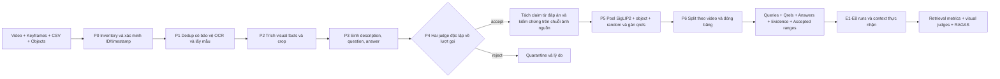
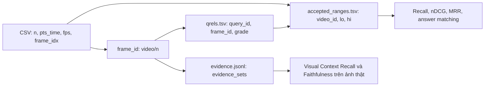

# Báo cáo pipeline tạo dữ liệu Video RAG Eval

Benchmark là **silver/pseudo-ground-truth** do MLLM sinh và kiểm chứng. Số liệu bên dưới lấy trực tiếp từ artifact; dấu `—` nghĩa là bước chưa chạy.

Nguồn yêu cầu: [bản sao plan gốc](source-plan-video-rag-eval.md). Dữ liệu gốc đọc tại `D:/keyframes`, `D:/map-keyframes`, `D:/video`; output tại `data/video_rag_eval`.

## Luồng tạo benchmark



## Dòng dữ liệu và khoảng chấp nhận



Với keyframe `frame_idx=351`, hai keyframe liền kề có `frame_idx=261` và `411`, nên khoảng đóng là `[262,410]`. Hit phải cùng `video_id`. Khoảng chồng nhau được gộp khi chấm để tránh cộng điểm lặp; qrels gốc vẫn giữ nguyên để truy vết. Keyframe đầu/cuối dùng giới hạn có trong CSV khi không có số frame cuối video đáng tin.

## Cách gán qrels và bằng chứng temporal

Mỗi QA lấy hợp frame nguồn, top 12 SigLIP2, tối đa 8 ứng viên cùng object và 3 frame ngẫu nhiên. ID trùng được loại trước khi chấm. Nhãn được ghi ngay vào `derived/pool_judgments.jsonl`; pool hữu hạn không chứng minh exhaustive relevance toàn corpus.

Mỗi lượt qrel xem **toàn bộ câu hỏi + các claim + một candidate frame**, có thể thêm crop của chính frame nguồn. Chưa tách câu hỏi thành sub-query; lượt qrel không xem cả chuỗi. Grade 3 trực tiếp trả lời; grade 2 gần đủ hoặc hỗ trợ một sự kiện của câu temporal; grade 1 cùng chủ đề; grade 0 đã judge là không liên quan. Grade 3 có lượt xác nhận thứ hai và đối chiếu đáp án theo đúng câu hỏi. `uncertain` hoặc bất đồng giữ là unjudged.

Hai frame grade 2 không tự chứng minh quan hệ thời gian. Chuỗi nguồn được judge chung ở bước xác minh QA/claim. Khi đánh giá, Context Recall và Faithfulness xem các ảnh/crop thực sự được cấp, kiểm tra cả hai trạng thái và quan hệ thứ tự. `supports_claim_ids` chỉ tham chiếu các claim mà lượt qrel đã nhận; `judged_claims` giữ nội dung claim của lượt đó khi claim được chuẩn hóa sau pilot.

## Chạy lại pipeline

```powershell
.venv\Scripts\python.exe -m video_rag_eval inventory --source-only
.venv\Scripts\python.exe -m video_rag_eval verify-index
.venv\Scripts\python.exe -m video_rag_eval sample
.venv\Scripts\python.exe -m video_rag_eval facts
.venv\Scripts\python.exe -m video_rag_eval generate
.venv\Scripts\python.exe -m video_rag_eval verify
.venv\Scripts\python.exe -m video_rag_eval claims
.venv\Scripts\python.exe -m video_rag_eval pool
.venv\Scripts\python.exe -m video_rag_eval freeze
.venv\Scripts\python.exe -m video_rag_eval smoke-metrics
1..8 | ForEach-Object { .venv\Scripts\python.exe -m video_rag_eval run --experiment "E$_" }
.venv\Scripts\python.exe -m video_rag_eval adjudicate
1..8 | ForEach-Object { .venv\Scripts\python.exe -m video_rag_eval score --run "data/video_rag_eval/runs/E$_.jsonl" }
.venv\Scripts\python.exe -m video_rag_eval report
.venv\Scripts\python.exe -m video_rag_eval audit
```

Các bước gọi MLLM cần `LLM_API_KEY` trong môi trường. CLI dừng khi thiếu key; không ghi key vào artifact. `--source-only` là phạm vi pilot; bỏ cờ để kiểm kê toàn corpus.

## Kiểm kê và chất lượng nhãn

| Chỉ số | Giá trị |
|---|---:|
| Video đã quét | 128 |
| Frame hợp lệ | 26003 |
| Frame/map quarantine | 0 |
| Video có file gốc | 128 |
| Nhóm dedup | 25874 |
| Frame lấy mẫu | 120 |
| Video có mẫu | 88 |
| Mẫu có OCR | 120 |
| Mẫu có object | 112 |
| Proposal được judge | 43 |
| QA chấp nhận | 25 |
| QA từ chối | 18 |
| Candidate qrels đã chấm | 416 |
| Candidate unjudged | 82 |
| Benchmark đã đóng băng | 20 |

Phân bố loại câu hỏi: `{"visible_action": 4, "spatial_count": 4, "multi_frame_temporal": 3, "unanswerable": 3, "object_attribute": 4, "ocr_signage": 2}`.

Phân bố qrels đã đóng băng theo grade: `{"0": 271, "3": 68, "2": 48, "1": 29}`. Số nhãn/query: **9–27**; positive ngoài frame nguồn/evidence gốc: **96**.

Judged coverage của pool đã lấy: **83.5%** (chỉ trên candidate pool, không phải độ phủ toàn corpus).

Quality gates từ chối QA: `{"answerability_mismatch": 2, "ocr_without_crop": 8, "reference_answer_mismatch": 4, "description_grounded": 5, "leaks_answer": 2}`.

Số QA có bất đồng giữa hai judge về ít nhất một cờ chất lượng: **6**.

Quarantine theo nguyên nhân: `{"[WinError 10061] No connection could be made because the target machine actively refused it": 2, "[SSL: CERTIFICATE_VERIFY_FAILED] certificate verify failed: unable to get local issuer certificate (_ssl.c:1016)": 120, "Expecting ',' delimiter: line 41 column 31 (char 1281)": 1, "Expecting property name enclosed in double quotes: line 5 column 6 (char 56)": 1, "12 validation errors for FactResponse\nvisual_facts.0.fact_id\n  Input should be a valid string [type=string_type, input_value=1, input_type=int]\n    For further information visit https://errors.pydantic.dev/2.13/v/string_type\nvisual_facts.1.fact_id\n  Input should be a valid string [type=string_type, input_value=2, input_type=int]\n    For further information visit https://errors.pydantic.dev/2.13/v/string_type\nvisual_facts.2.fact_id\n  Input should be a valid string [type=string_type, input_value=3, input_type=int]\n    For further information visit https://errors.pydantic.dev/2.13/v/string_type\nvisual_facts.3.fact_id\n  Input should be a valid string [type=string_type, input_value=4, input_type=int]\n    For further information visit https://errors.pydantic.dev/2.13/v/string_type\nvisual_facts.4.fact_id\n  Input should be a valid string [type=string_type, input_value=5, input_type=int]\n    For further information visit https://errors.pydantic.dev/2.13/v/string_type\nvisual_facts.5.fact_id\n  Input should be a valid string [type=string_type, input_value=6, input_type=int]\n    For further information visit https://errors.pydantic.dev/2.13/v/string_type\nvisual_facts.6.fact_id\n  Input should be a valid string [type=string_type, input_value=7, input_type=int]\n    For further information visit https://errors.pydantic.dev/2.13/v/string_type\nvisual_facts.7.fact_id\n  Input should be a valid string [type=string_type, input_value=8, input_type=int]\n    For further information visit https://errors.pydantic.dev/2.13/v/string_type\nvisual_facts.8.fact_id\n  Input should be a valid string [type=string_type, input_value=9, input_type=int]\n    For further information visit https://errors.pydantic.dev/2.13/v/string_type\nvisual_facts.9.fact_id\n  Input should be a valid string [type=string_type, input_value=10, input_type=int]\n    For further information visit https://errors.pydantic.dev/2.13/v/string_type\nvisual_facts.10.fact_id\n  Input should be a valid string [type=string_type, input_value=11, input_type=int]\n    For further information visit https://errors.pydantic.dev/2.13/v/string_type\nvisual_facts.11.fact_id\n  Input should be a valid string [type=string_type, input_value=12, input_type=int]\n    For further information visit https://errors.pydantic.dev/2.13/v/string_type": 1}`.

Chi phí theo stage (ước tính USD): `{"facts": 0.03689, "generate": 0.02773, "verify_a": 0.0174, "verify_b": 0.02021, "answer_equivalence": 0.01341, "qrel": 0.18711, "qrel_confirm": 0.04717, "qrel_answer_equivalence": 0.02451, "answer_claim_decomposition": 0.00241, "answer_claim_verification": 0.0054, "smoke_context_recall": 0.00035, "smoke_visual_faithfulness": 0.00046, "ragas_faithfulness_and_answer_relevancy": 5.65, "run_query": 0.0038, "run_answer": 0.06909, "runtime_crop": 0.01257, "shot_summary": 0.01272, "E8_agent": 0.11554, "eval_qrel": 0.09334, "eval_qrel_confirm": 0.02462, "eval_qrel_answer_equivalence": 0.00947, "answer_correctness_equivalence": 0.01563, "visual_context_recall": 0.06417, "visual_faithfulness": 0.08789}`.

Model: `qwen/qwen3.8-flash`; hai lượt judge dùng cùng checkpoint, prompt độc lập. OpenRouter key: **đã cấu hình**; inference access: **đã xác minh**. Chi phí ước tính: **$6.5419 USD**; giá API có thể đổi.


## Kết quả E1–E8

| Cấu hình | Context Recall | Context Precision | Faithfulness | Answer Relevance | #queries |
|---|---:|---:|---:|---:|---:|
| E1 | 0.528 | 0.417 | 0.786 | 0.655 | 14 |
| E2 | 0.472 | 0.476 | 0.571 | 0.680 | 14 |
| E3 | 0.639 | 0.476 | 0.692 | 0.715 | 14 |
| E4 | 0.333 | 0.108 | 1.000 | 0.748 | 14 |
| E5 | 0.639 | 0.476 | 0.786 | 0.796 | 14 |
| E6 | 0.569 | 0.276 | 0.714 | 0.740 | 14 |
| E7 | 0.639 | 0.476 | 0.714 | 0.673 | 14 |
| E8 | 0.694 | 0.603 | 0.929 | 0.750 | 14 |

Số query có điểm hợp lệ được báo riêng; mẫu unanswerable không có Context Recall tham chiếu, và context còn unjudged không nhận AP giả bằng 0.

| Cấu hình | N Recall | N Precision | N Faithfulness | N Relevance |
|---|---:|---:|---:|---:|
| E1 | 12 | 9 | 14 | 14 |
| E2 | 12 | 9 | 14 | 14 |
| E3 | 12 | 9 | 13 | 13 |
| E4 | 12 | 7 | 14 | 14 |
| E5 | 12 | 9 | 14 | 14 |
| E6 | 12 | 7 | 14 | 14 |
| E7 | 12 | 9 | 14 | 14 |
| E8 | 12 | 7 | 14 | 14 |

## Metric bổ sung

| Cấu hình | Recall@50 | nDCG@10 | Answer correctness | Citation accuracy | Rejection | P95 ms | Cost USD |
|---|---:|---:|---:|---:|---:|---:|---:|
| E1 | 0.578 | 0.512 | 0.250 | 0.500 | 1.000 | 40958.557 | 0.013 |
| E2 | 0.612 | 0.587 | 0.250 | 0.636 | 1.000 | 20369.268 | 0.010 |
| E3 | 0.607 | 0.588 | 0.250 | 0.636 | 1.000 | 22952.490 | 0.009 |
| E4 | 0.612 | 0.427 | 0.167 | 0.450 | 1.000 | 16720.504 | 0.009 |
| E5 | 0.612 | 0.587 | 0.167 | 0.583 | 1.000 | 80909.801 | 0.022 |
| E6 | 0.612 | 0.587 | 0.250 | 0.569 | 0.500 | 16280.671 | 0.012 |
| E7 | 0.612 | 0.587 | 0.250 | 0.636 | 1.000 | 105769.530 | 0.022 |
| E8 | 0.612 | 0.587 | 0.250 | 0.512 | 1.000 | 166367.400 | 0.127 |

Chi phí trong bảng gồm các lượt model của run, kể cả controller/VLM của E8; các lượt judge/RAGAS nằm trong chi phí theo stage phía trên. Query variants được cache dùng chung, nên chi phí tạo cache thuộc cấu hình chạy đầu tiên.

## Theo loại câu hỏi

| Cấu hình | Loại | #queries | Context Recall | Context Precision | Correctness |
|---|---|---:|---:|---:|---:|
| E1 | multi_frame_temporal | 3 | 0.111 | 0.511 | 0.000 |
| E1 | object_attribute | 1 | 1.000 | 0.804 | 0.000 |
| E1 | ocr_signage | 2 | 0.500 | 0.000 | 0.500 |
| E1 | spatial_count | 4 | 0.500 | 1.000 | 0.250 |
| E1 | unanswerable | 2 | — | 0.000 | — |
| E1 | visible_action | 2 | 1.000 | 0.417 | 0.500 |
| E2 | multi_frame_temporal | 3 | 0.222 | 0.631 | 0.000 |
| E2 | object_attribute | 1 | 1.000 | 0.887 | 0.000 |
| E2 | ocr_signage | 2 | 0.500 | 0.000 | 0.500 |
| E2 | spatial_count | 4 | 0.500 | 1.000 | 0.250 |
| E2 | unanswerable | 2 | — | 0.000 | — |
| E2 | visible_action | 2 | 0.500 | 0.500 | 0.500 |
| E3 | multi_frame_temporal | 3 | 0.222 | 0.631 | 0.000 |
| E3 | object_attribute | 1 | 1.000 | 0.887 | 0.000 |
| E3 | ocr_signage | 2 | 0.500 | 0.000 | 0.500 |
| E3 | spatial_count | 4 | 0.750 | 1.000 | 0.250 |
| E3 | unanswerable | 2 | — | 0.000 | — |
| E3 | visible_action | 2 | 1.000 | 0.500 | 0.500 |
| E4 | multi_frame_temporal | 3 | 0.000 | 0.252 | 0.000 |
| E4 | object_attribute | 1 | 1.000 | — | 0.000 |
| E4 | ocr_signage | 2 | 0.500 | 0.000 | 0.500 |
| E4 | spatial_count | 4 | 0.250 | 0.000 | 0.000 |
| E4 | unanswerable | 2 | — | 0.000 | — |
| E4 | visible_action | 2 | 0.500 | — | 0.500 |
| E5 | multi_frame_temporal | 3 | 0.222 | 0.631 | 0.000 |
| E5 | object_attribute | 1 | 1.000 | 0.887 | 0.000 |
| E5 | ocr_signage | 2 | 0.500 | 0.000 | 0.000 |
| E5 | spatial_count | 4 | 0.750 | 1.000 | 0.250 |
| E5 | unanswerable | 2 | — | 0.000 | — |
| E5 | visible_action | 2 | 1.000 | 0.500 | 0.500 |
| E6 | multi_frame_temporal | 3 | 0.111 | 0.477 | 0.000 |
| E6 | object_attribute | 1 | 1.000 | — | 0.000 |
| E6 | ocr_signage | 2 | 0.500 | 0.000 | 0.500 |
| E6 | spatial_count | 4 | 0.750 | 0.500 | 0.250 |
| E6 | unanswerable | 2 | — | 0.000 | — |
| E6 | visible_action | 2 | 0.750 | — | 0.500 |
| E7 | multi_frame_temporal | 3 | 0.222 | 0.631 | 0.000 |
| E7 | object_attribute | 1 | 1.000 | 0.887 | 0.000 |
| E7 | ocr_signage | 2 | 0.500 | 0.000 | 0.500 |
| E7 | spatial_count | 4 | 0.750 | 1.000 | 0.250 |
| E7 | unanswerable | 2 | — | 0.000 | — |
| E7 | visible_action | 2 | 1.000 | 0.500 | 0.500 |
| E8 | multi_frame_temporal | 3 | 0.111 | 0.778 | 0.000 |
| E8 | object_attribute | 1 | 1.000 | 0.917 | 0.000 |
| E8 | ocr_signage | 2 | 1.000 | 0.250 | 0.500 |
| E8 | spatial_count | 4 | 0.750 | 1.000 | 0.250 |
| E8 | unanswerable | 2 | — | 0.000 | — |
| E8 | visible_action | 2 | 1.000 | 0.500 | 0.500 |

Context Recall là visual claim recall; Context Precision là AP từ qrels với ngưỡng relevance ≥2. Faithfulness là RAGAS multimodal binary; Answer Relevance là RAGAS AnswerRelevancy với SigLIP2 text embedding cục bộ. nDCG/MRR dùng thứ hạng đã bỏ kết quả unjudged, đồng thời báo judged coverage.

## Giới hạn

- Khoảng frame là dung sai chấm truy hồi, không xác nhận mọi ảnh trong khoảng chứa cùng bằng chứng.
- Pool hữu hạn không exhaustively phán nhãn toàn corpus; unjudged không phải negative.
- Cùng checkpoint Qwen cho các judge có thể tạo sai lệch chung.
- AnswerRelevancy dùng SigLIP2 text embedding cùng họ với retriever; diễn giải kết quả với giới hạn phụ thuộc encoder.
- Xem [bảng đối chiếu yêu cầu](video-rag-eval-requirements.md) để biết các bước chưa đạt.

## Nguồn tham chiếu đã kiểm tra

- [Google SigLIP2 model card và cách dùng AutoModel/AutoProcessor](https://huggingface.co/google/siglip2-base-patch16-512). Hash model/processor cục bộ và parity Milvus nằm trong `derived/index_verification.json`.
- [RAGAS 0.4.3 MultiModalFaithfulness](https://docs.ragas.io/en/v0.4.3/concepts/metrics/available_metrics/multi_modal_faithfulness/). Smoke artifact xác nhận verdict binary trên ảnh thật.
- [OpenRouter Qwen3.8 Flash](https://openrouter.ai/qwen/qwen3.8-flash) và [reasoning budget](https://openrouter.ai/docs/guides/best-practices/reasoning-tokens). Ledger dùng giá input/output 0,15/0,47 USD mỗi triệu token; chi phí RAGAS là allowance ước tính.
